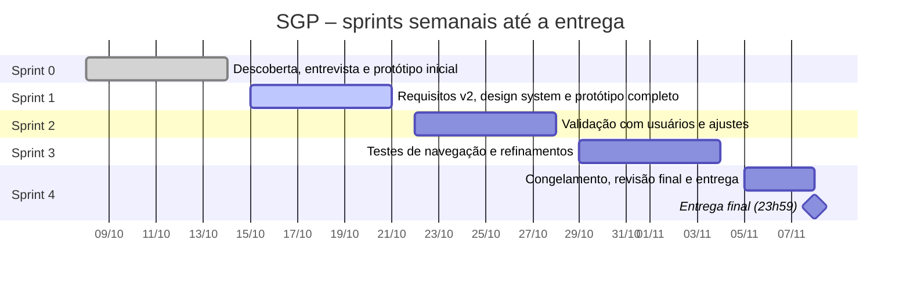

# 01 – Plano de projeto

| | |
|---|---|
| **Projeto** | SGP – Sistema de Gestão de Portarias |
| **Instituição** | Instituto Federal Catarinense – Campus Videira |
| **Cliente / patrocinador** | Diretor-Geral do Campus Videira |
| **Equipe** | Victor Casagrande, Lucas Duarte Lopes, Willighan Tinelli de Souza |
| **Metodologia** | Scrum, com sprints semanais |
| **Prazo final** | 08/11/2026, 23h59 |
| **Versão do documento** | 1.0 – 15/10/2026 |

## 1. Contexto e problema

Hoje as portarias do campus são controladas em planilhas e pastas. A entrevista com o Diretor-Geral levantou os principais problemas:

- os pedidos chegam por e-mail e os nomes dos membros são digitados à mão;
- as portarias ficam espalhadas, sem busca por servidor, tipo, órgão ou período;
- a carga horária de cada servidor em portarias é somada manualmente, e o limite de 10 h semanais dos docentes nem sempre é percebido a tempo;
- o vencimento de uma portaria costuma ser descoberto depois que já passou, deixando a comissão sem cobertura legal;
- os mesmos dados são digitados na planilha e de novo no SIPAC;
- montar o histórico de portarias de um servidor para a progressão funcional exige procurar documento por documento.

## 2. Objetivo

Projetar um sistema web que concentre todo o ciclo de vida das portarias do campus: solicitação, análise, elaboração guiada, assinatura no SIPAC, publicação, ciência dos membros, alteração, retificação e revogação. O sistema deve controlar automaticamente os limites de carga horária e preservar o histórico de forma permanente.

### Objetivos específicos

1. Eliminar as planilhas paralelas, com uma única base consultável.
2. Bloquear designações que ultrapassem a jornada contratual ou o limite docente (RN04).
3. Avisar presidentes, chefias e Gabinete antes do vencimento (RN08).
4. Gerar o extrato curricular do servidor sem esforço manual (RF12).
5. Dar transparência pública às portarias, respeitando a LGPD (RN06).

## 3. Escopo

### Dentro do escopo (este trabalho)

| Entregável | Onde está |
|---|---|
| Plano de projeto, EAP e mapeamento de talentos | `docs/01` a `docs/03` |
| Requisitos funcionais, não funcionais e regras de negócio | `docs/05`, `docs/06` e página **Requisitos** do Figma |
| Critérios de aceitação | `docs/04` |
| Design system: paleta, estilos de texto, cor, efeito e grade, componentes com variantes | Página **Design System** do Figma · `docs/10` |
| Interfaces obrigatórias: login, recuperação de senha e Home com menu | Página **Telas (protótipo)** · `docs/07` |
| Protótipo funcional e navegável de todos os perfis | Página **Telas (protótipo)** · `docs/08` |
| Landing page | Página **Telas (protótipo)** · `docs/09` |

### Fora do escopo

- Codificação, banco de dados e implantação do sistema.
- Implementação das integrações com o LDAP/AD da Reitoria e com o SIPAC (consideradas garantidas).
- Importação das portarias antigas de 2010 a 2016 (RNF07, fase futura).
- Exportação para planilhas (RNF06; decisão do cliente).
- Fila offline para o caso de o SIPAC estar fora do ar (RNF02).

## 4. Partes interessadas

| Parte interessada | Interesse no SGP | Perfil no sistema |
|---|---|---|
| Diretor-Geral | Cliente; assina as portarias; quer controle e transparência | Gestão |
| Diretora de Ensino | Avalia exceções ao limite docente de 10 h | Gestão |
| Diretor Administrativo e Chefe de Gabinete | Acompanham portarias administrativas e contratos | Gestão |
| Gabinete e CGP | Emitem, alteram, retificam e revogam portarias | Emissor |
| Coordenadores de curso e presidentes de comissão | Pedem portarias, alterações e prorrogações | Solicitante |
| Chefias de setor | Acompanham a carga horária do próprio setor | Chefia de setor |
| Servidores (docentes e TAE) | Dão ciência e consultam o próprio extrato | Servidor |
| Comunidade externa | Consulta portarias publicadas | Público |
| Professor da disciplina | Avalia o trabalho | — |

## 5. Metodologia: Scrum

### 5.1 Papéis

| Papel | Responsável | Responsabilidades |
|---|---|---|
| **Product Owner** | Victor Casagrande | Mantém e prioriza o backlog; representa o Diretor-Geral e os usuários; aceita ou recusa os itens na revisão da sprint |
| **Scrum Master** | Lucas Duarte Lopes | Conduz os eventos; remove impedimentos; garante que o processo e a Definição de Pronto sejam seguidos |
| **Time de desenvolvimento** | Victor, Lucas e Willighan | Especificação, design de interface, prototipação, documentação e testes de navegação |

O Diretor-Geral é a principal parte interessada externa. As dúvidas de negócio são levadas a ele ou ao professor por meio do Product Owner.

### 5.2 Eventos

| Evento | Quando | Duração | Saída |
|---|---|---|---|
| Sprint planning | Quinta-feira, início da sprint | 30 min | Meta da sprint e itens escolhidos |
| Daily (assíncrona) | Todos os dias, no grupo da equipe | 5 min por pessoa | O que fiz, o que farei, o que me impede |
| Sprint review | Quarta-feira, fim da sprint | 30 min | Itens aceitos pelo PO e itens que voltam ao backlog |
| Retrospectiva | Logo após a review | 15 min | Uma melhoria de processo para a sprint seguinte |

### 5.3 Artefatos

- **Product backlog:** seção 7 deste documento.
- **Sprint backlog:** os itens de cada sprint na seção 6.
- **Incremento:** as telas no Figma e os documentos deste repositório, versionados a cada sprint.
- **Definição de Pronto:** ver [04 – Critérios de aceitação](04-criterios-de-aceitacao.md#definição-de-pronto-dod).

## 6. Cronograma de sprints

| Sprint | Período | Meta da sprint | Principais itens |
|---|---|---|---|
| 0 – Descoberta | 08/10 – 14/10 | Entender o problema e ter um primeiro protótipo | Entrevista com o Diretor-Geral; requisitos v1; landing page e telas iniciais no Figma |
| 1 | 15/10 – 21/10 | Requisitos revisados e protótipo completo, navegável de ponta a ponta | Requisitos v2 conferidos com a gravação; design system com estilos e componentes; todas as telas e fluxos; documentação do repositório |
| 2 | 22/10 – 28/10 | Validar o protótipo com quem vai usar | Apresentar ao professor e, se possível, ao Gabinete/CGP; registrar as dúvidas abertas (seção 10); ajustar telas e regras |
| 3 | 29/10 – 04/11 | Protótipo sem pontas soltas | Teste de navegação de todos os fluxos por um integrante que não desenhou a tela; revisão de textos e acessibilidade (contraste, tamanhos); revisão cruzada da documentação |
| 4 | 05/11 – 08/11 | Entregar | Congelar o Figma; compartilhar com edição para `tiago.goncalves@ifc.edu.br`; commit final do repositório até 08/11, 23h59 |

## 7. Product backlog

Prioridade pelo método MoSCoW (**M**ust, **S**hould, **C**ould, **W**on't). Estimativa em pontos (Fibonacci), medindo o esforço de especificar, desenhar e prototipar o item.

| ID | História de usuário | Requisitos | Prior. | Pts | Sprint | Situação |
|---|---|---|---|---|---|---|
| US01 | Como **visitante**, quero conhecer o SGP por uma landing page, para entender o que ele resolve antes de entrar | Landing | M | 5 | 0–1 | Pronto |
| US02 | Como **servidor**, quero entrar com meu usuário e senha institucionais, para não ter outra senha | RNF01 | M | 3 | 1 | Pronto |
| US03 | Como **servidor**, quero recuperar minha senha por e-mail, para voltar a acessar sem abrir chamado | RNF01 | M | 3 | 1 | Pronto |
| US04 | Como **servidor**, quero uma página inicial com menu e resumo das minhas pendências, para saber o que fazer | RF09, RF10 | M | 5 | 1 | Pronto |
| US05 | Como **solicitante**, quero pedir uma portaria pelo sistema, escolhendo os membros da base, para não depender de e-mail | RF01 | M | 5 | 1 | Pronto |
| US06 | Como **emissor**, quero analisar os pedidos e aprovar ou devolver com comentário, para evitar portarias incompletas | RF02 | M | 3 | 1 | Pronto |
| US07 | Como **emissor**, quero elaborar a portaria em etapas guiadas com prévia, para manter o padrão do campus | RF03, RN02 | M | 8 | 0–1 | Pronto |
| US08 | Como **emissor**, quero ser impedido de designar alguém acima do limite de horas, para cumprir o regulamento | RF04, RF09, RN04 | M | 5 | 1 | Pronto |
| US09 | Como **emissor**, quero enviar a portaria para assinatura no SIPAC sem redigitar dados | RF05, RNF02 | M | 3 | 1 | Pronto |
| US10 | Como **emissor**, quero ver o estado de cada portaria, para saber onde ela está parada | RF06 | M | 3 | 1 | Pronto |
| US11 | Como **emissor**, quero trocar membros com documento acessório e datas de saída e entrada | RF07, RN03 | M | 5 | 1 | Pronto |
| US12 | Como **emissor**, quero retificar erros materiais e revogar portarias por nova portaria | RF08, RN03 | M | 5 | 1 | Pronto |
| US13 | Como **membro**, quero ser avisado e registrar ciência do teor da portaria | RF10 | M | 3 | 1 | Pronto |
| US14 | Como **qualquer pessoa**, quero consultar portarias publicadas sem login | RF11, RN06 | M | 5 | 1 | Pronto |
| US15 | Como **servidor**, quero meu extrato de portarias para a progressão funcional | RF12 | M | 3 | 1 | Pronto |
| US16 | Como **gestão** ou **chefia**, quero relatórios de carga horária e histórico por objeto | RF13, RN05 | S | 5 | 1 | Pronto |
| US17 | Como **emissor**, quero gerar o Boletim de Serviço do mês automaticamente | RF14 | S | 3 | 1 | Pronto |
| US18 | Como **qualquer perfil autorizado**, quero ver o histórico completo de versões da portaria | RF15, RN09 | M | 3 | 1 | Pronto |
| US19 | Como **equipe**, queremos um design system com paleta, estilos e componentes, para manter a consistência | — | M | 8 | 1 | Pronto |
| US20 | Como **equipe**, queremos validar o protótipo com o professor e com o Gabinete/CGP | — | S | 3 | 2 | A fazer |
| US21 | Como **equipe**, queremos testar todos os fluxos do protótipo com alguém que não os desenhou | — | M | 3 | 3 | A fazer |
| US22 | Como **equipe**, queremos criar estilos de animação no Figma para as transições | — | C | 2 | 3 | A fazer |
| US23 | Como **equipe**, queremos campos de seleção (selects) interativos no protótipo | — | S | 3 | 1 | Pronto |
| US24 | Como **emissor**, quero importar as portarias de 2010 a 2016 | RNF07 | W | 13 | — | Fase futura |

**Velocidade:** a Sprint 1 concentrou o maior volume (US02 a US19, cerca de 80 pontos). As sprints 2 a 4 têm carga menor e são reservadas para validação, testes e ajustes.

## 8. Entregáveis e marcos

| Marco | Data | Critério |
|---|---|---|
| Requisitos v2 aprovados pelo PO | 21/10/2026 | RN, RF e RNF conferidos com a gravação da entrevista |
| Protótipo completo | 21/10/2026 | Todos os fluxos navegáveis, sem links quebrados |
| Protótipo validado | 28/10/2026 | Ajustes da validação aplicados |
| Congelamento | 05/11/2026 | Nenhuma tela nova; só correções |
| **Entrega final** | **08/11/2026, 23h59** | Figma compartilhado com edição e repositório publicado |

## 9. Riscos

| # | Risco | Prob. | Impacto | Resposta |
|---|---|---|---|---|
| R1 | Atraso na entrega (nota zero) | Baixa | Muito alto | Congelamento em 05/11; entrega planejada para 07/11, com um dia de folga |
| R2 | Professor sem acesso ao Figma ou ao repositório (nota zero) | Média | Muito alto | Compartilhar com edição já na Sprint 2 e pedir confirmação de acesso; repositório público |
| R3 | Regra de negócio mal interpretada da entrevista | Média | Alto | Requisitos com horário da gravação; dúvidas levadas ao professor (seção 10) |
| R4 | Integrante indisponível em uma sprint | Média | Médio | Cada entregável tem responsável e apoio definidos na matriz RACI |
| R5 | Alterações no Figma quebrarem links do protótipo | Média | Médio | Teste de navegação completo na Sprint 3 e de novo após o congelamento |
| R6 | Divergência entre o Figma e a documentação | Média | Médio | Revisão cruzada na Sprint 3; os documentos citam os nomes exatos das telas |
| R7 | Semelhança com trabalhos de outros grupos | Baixa | Muito alto | Conteúdo baseado na entrevista própria do grupo, com fontes citadas |

## 10. Questões em aberto (para o professor ou o cliente)

1. **Exceção ao limite de 10 h docente:** a Diretora de Ensino aprova pelo próprio sistema (desbloqueando a inclusão) ou fora dele? Hoje o protótipo apenas bloqueia.
2. **Prorrogação:** o protótipo trata a prorrogação como uma nova portaria com o mesmo objeto (pedida pelo solicitante ou iniciada pelo emissor). Confirmar se o campus prefere uma alteração do prazo da portaria original.
3. **Vigência (RN02):** confirmar com o Gabinete quais atos do campus exigem publicação no DOU.
4. **Antecedência dos avisos de vencimento:** o protótipo mostra o aviso faltando 3 dias; falta definir com quantos dias de antecedência o primeiro aviso é enviado.
5. **Setores emissores:** confirmar se, além do Gabinete e da CGP, algum outro setor do Campus Videira emite portarias.

## 11. Comunicação e ferramentas

| Ferramenta | Uso |
|---|---|
| Figma | Design system, telas, protótipo navegável e página de requisitos |
| GitHub | Documentação do projeto (este repositório) |
| Grupo de mensagens da equipe | Daily assíncrona e avisos rápidos |
| Reunião presencial ou online | Planning, review e retrospectiva |
| E-mail institucional | Comunicação com o professor e com o cliente |

## 12. Premissas e restrições

- **Premissa:** o acesso ao LDAP/AD da Reitoria e ao SIPAC está garantido. O SGP lê de lá nome, nome social, SIAPE, CPF, vínculo e lotação.
- **Premissa:** um usuário pode acumular perfis; o perfil vem do cadastro e não é escolhido na tela de login.
- **Restrição:** trabalho em grupo de três integrantes, com prazo fixo de 08/11/2026, 23h59.
- **Restrição:** o protótipo é feito no Figma; não há código executável.
