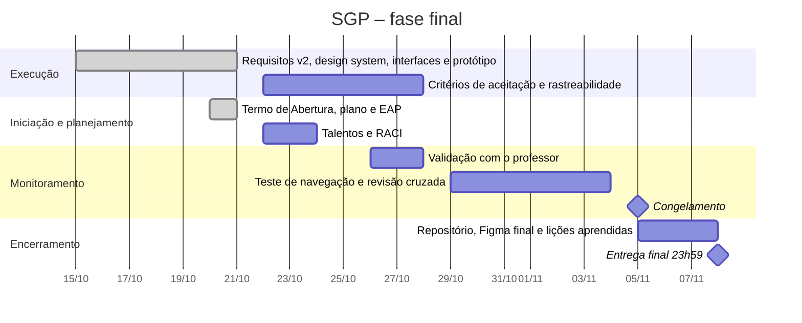

# 01b – Planejamento detalhado

Complemento do [Plano de Projeto (Termo de Abertura)](01-plano-de-projeto.md): aqui estão o ciclo de vida, os papéis, o cronograma, o backlog, os riscos e a gestão da qualidade.

| | |
|---|---|
| **Projeto** | SGP – Sistema de Gestão de Portarias |
| **Instituição** | Instituto Federal Catarinense – Campus Videira |
| **Product Owner (cliente)** | Diretor-Geral do Campus Videira |
| **Equipe** | Victor Casagrande, Lucas Duarte Lopes, Willighan Tinelli de Souza |
| **Disciplinas** | Engenharia de Software I (levantamento, 1º semestre de 2026) e Engenharia de Software II (gestão, protótipo e entrega, 2º semestre de 2026) |
| **Metodologia** | Ciclo de vida do PMI, com Scrum em sprints semanais na execução |
| **Prazo final** | 08/11/2026, 23h59 |
| **Documento de origem** | [01 – Plano de Projeto (Termo de Abertura)](01-plano-de-projeto.md) |
| **Versão do documento** | 2.2 – 28/10/2026 |

## 1. Contexto e problema

Hoje as portarias do campus são controladas em planilhas e pastas. A entrevista com o Diretor-Geral, em 30/03/2026, levantou os principais problemas:

- os pedidos chegam por e-mail e os nomes dos membros são digitados à mão;
- as portarias ficam espalhadas, sem busca por servidor, tipo, órgão ou período;
- a carga horária de cada servidor em portarias é somada manualmente, e o limite de 10 h semanais dos docentes nem sempre é percebido a tempo;
- o vencimento de uma portaria costuma ser descoberto depois que já passou, deixando a comissão sem cobertura legal;
- os mesmos dados são digitados na planilha e de novo no SIPAC;
- montar o histórico de portarias de um servidor para a progressão funcional exige procurar documento por documento.

## 2. Objetivos

**Objetivo geral:** projetar, até 08/11/2026, um sistema web que concentre todo o ciclo de vida das portarias do campus (solicitação, análise, elaboração guiada, assinatura no SIPAC, publicação, ciência, alteração, retificação e revogação), com controle automático de carga horária e histórico permanente.

**Objetivos SMART do projeto**

| # | Objetivo | Medida | Prazo |
|---|---|---|---|
| O1 | Entregar os 9 artefatos exigidos | 9 de 9 no repositório; Figma com edição para o professor | 08/11/2026, 23h59 |
| O2 | Protótipo navegável para todos os perfis | 5 perfis e 9 fluxos sem nenhum link quebrado | 28/10/2026 |
| O3 | Rastrear todos os requisitos | 100% dos RF ligados a tela e a critério de aceitação | 28/10/2026 |
| O4 | Basear as regras no cliente | 100% das regras de negócio com trecho da entrevista como fonte | 21/10/2026 |

**Objetivos do produto (o que o SGP deve resolver)**

1. Eliminar as planilhas paralelas, com uma única base consultável.
2. Bloquear designações que ultrapassem a jornada contratual ou o limite docente (RN04).
3. Avisar presidentes, chefias e Gabinete antes do vencimento (RN08).
4. Gerar o extrato curricular do servidor sem esforço manual (RF12).
5. Dar transparência pública às portarias, respeitando a LGPD (RN06).

## 3. Escopo

O escopo completo está decomposto na [EAP](02-eap.md); o que não está nela não faz parte do projeto.

### Dentro do escopo

| Entregável | Onde está |
|---|---|
| Plano de Projeto (Termo de Abertura), planejamento detalhado, EAP e mapeamento de talentos | `docs/01` a `docs/03` |
| Critérios de aceitação | `docs/04` |
| Requisitos funcionais, não funcionais e regras de negócio | `docs/05`, `docs/06` e página **Requisitos** do Figma |
| Interfaces obrigatórias: login, recuperação de senha e Home com menu | Página **Telas (protótipo)** · `docs/07` |
| Protótipo funcional e navegável de todos os perfis | Página **Telas (protótipo)** · `docs/08` |
| Landing page | Página **Telas (protótipo)** · `docs/09` |
| Design system: paleta, estilos de texto, cor, efeito, grade e animação, componentes | Página **Design System** do Figma · `docs/10` |

### Fora do escopo

- Codificação, banco de dados, testes automatizados e implantação do sistema.
- Implementação das integrações com o LDAP/AD da Reitoria e com o SIPAC (consideradas garantidas).
- Importação das portarias antigas de 2010 a 2016 (RNF07, fase futura).
- Exportação para planilhas (RNF06; decisão do cliente).
- Fila offline para o caso de o SIPAC estar fora do ar (RNF02).
- **Versões para celular e tablet.** O SGP é um sistema administrativo usado em computadores do campus; as telas foram desenhadas para 1440 px. A adaptação responsiva fica registrada no backlog (US25) para uma fase futura. A consulta pública é a primeira candidata, por ser a única tela usada por pessoas de fora.

## 4. Partes interessadas

Classificadas nas três categorias vistas na disciplina.

| Categoria | Parte interessada | Interesse no SGP | Perfil no sistema |
|---|---|---|---|
| **Equipe do projeto** | Victor Casagrande, Lucas Duarte Lopes, Willighan Tinelli de Souza | Projetar o sistema e entregar os artefatos | — |
| **Equipe do projeto** | Prof. Tiago Gonçalves | Orientar e avaliar o projeto | — |
| **Clientes** | Diretor-Geral do Campus Videira (Product Owner) | Controle das portarias e transparência; assina no SIPAC | Gestão |
| **Clientes** | Gabinete e CGP | Emitir, alterar, retificar e revogar portarias | Emissor |
| **Clientes** | Coordenadores de curso e presidentes de comissão | Pedir portarias, alterações e prorrogações | Solicitante |
| **Clientes** | Diretora de Ensino, Diretor Administrativo e Chefe de Gabinete | Relatórios completos; exceções ao limite docente | Gestão |
| **Clientes** | Chefias de setor | Carga horária do próprio setor | Chefia de setor |
| **Clientes** | Servidores (docentes e TAE) | Dar ciência e consultar o próprio extrato | Servidor |
| **Outras partes interessadas** | DTIC do campus | Suporte ao login e às integrações | — |
| **Outras partes interessadas** | Reitoria (LDAP/AD) e equipe do SIPAC | Sistemas dos quais o SGP depende | — |
| **Outras partes interessadas** | Comunidade externa | Consultar portarias publicadas | Público |

## 5. Ciclo de vida e metodologia

O projeto segue as cinco etapas do ciclo de vida do PMI, que também formam o nível 1 da EAP. A execução da fase final usa Scrum, com sprints semanais.

| Etapa | O que aconteceu ou acontece | Quando |
|---|---|---|
| **Iniciação** | Entrevista com o Product Owner, anotações no Miro, transcrição; Termo de Abertura | 30/03/2026 (ES I) · TAP em 21/10/2026 |
| **Planejamento** | Planejamento detalhado, EAP, mapeamento de talentos, matriz RACI e backlog | ES II, até 22/10/2026 |
| **Execução** | Requisitos, design system, interfaces, protótipo e landing page; primeiros esboços ainda em ES I | ES I (esboços) · Sprints 1 a 3 |
| **Monitoramento e controle** | Revisões e retrospectivas de sprint, teste de navegação, revisão cruzada, validação com o professor | Sprints 1 a 4 |
| **Encerramento** | Entrega do repositório e do Figma; lições aprendidas | Sprint 4, até 08/11/2026 |

### 5.1 Papéis

Os papéis seguem os vistos em Engenharia de Software I (gerente de projeto, analista, designer e engenheiro de software) e os papéis do Scrum.

| Papel | Quem | Responsabilidades |
|---|---|---|
| **Product Owner** | Diretor-Geral do Campus Videira | Dono do produto: define as necessidades, prioriza e valida o que é entregue |
| **Representante do PO na equipe** | Victor Casagrande | Leva as dúvidas ao PO ou ao professor, mantém o backlog priorizado e aceita os itens na revisão da sprint |
| **Analista de Requisitos** | Victor Casagrande | Requisitos, regras de negócio, critérios de aceitação e teste de navegação |
| **Scrum Master** | Lucas Duarte Lopes | Conduz os eventos, remove impedimentos, garante a Definição de Pronto |
| **Designer UI/UX** | Lucas Duarte Lopes | Design system, interfaces, sobreposições e landing page |
| **Gerente de Projeto** | Willighan Tinelli de Souza | Termo de Abertura, plano, EAP, cronograma, riscos, RACI e repositório |
| **Engenheiro de Software (protótipo)** | Willighan Tinelli de Souza | Conexões e fluxos do protótipo, rastreabilidade e revisão cruzada |

Os papéis foram atribuídos pelos níveis da [matriz de habilidades](03-mapeamento-de-talentos.md#2-matriz-de-habilidades).

Como o PO não participa do dia a dia da equipe, as decisões rápidas são tomadas pelo representante e confirmadas com o PO ou com o professor (ver decisões confirmadas com o professor, seção 10).

### 5.2 Eventos do Scrum

| Evento | Quando | Duração | Saída |
|---|---|---|---|
| Sprint planning | Quinta-feira, início da sprint | 30 min | Meta da sprint e itens escolhidos |
| Daily (assíncrona) | Todos os dias, no grupo da equipe | 5 min por pessoa | O que fiz, o que farei, o que me impede |
| Sprint review | Quarta-feira, fim da sprint | 30 min | Itens aceitos e itens que voltam ao backlog |
| Retrospectiva | Logo após a review | 15 min | Uma melhoria de processo para a sprint seguinte |

### 5.3 Artefatos

- **Product backlog:** seção 7 deste documento.
- **Sprint backlog:** os pacotes de cada sprint no cronograma (seção 6).
- **Incremento:** as telas no Figma e os documentos deste repositório, versionados a cada sprint.
- **Definição de Pronto:** ver [04 – Critérios de aceitação](04-criterios-de-aceitacao.md#definição-de-pronto-dod).

## 6. Cronograma

O cronograma é formado pelas atividades derivadas dos pacotes de trabalho da EAP, com datas, dependências e marcos. A dependência usada é **término para início**: uma atividade só começa quando a predecessora termina.

### Fase 1 – Engenharia de Software I (1º semestre de 2026)

| Pacote | Atividade | Quando | Situação |
|---|---|---|---|
| 1.1.1 | Roteiro da entrevista | Antes de 30/03/2026 | Concluído |
| 1.1.2 | Entrevista com o Product Owner | **30/03/2026** | Concluído |
| 1.1.3 | Transcrição da entrevista (revisada na Fase 2) | 1º semestre · revisão em 10/2026 | Concluído |
| 3.4.1 | Protótipos de baixa e média fidelidade (Miro e Figma) | 1º semestre | Concluído |

### Fase 2 – Engenharia de Software II (sprints semanais)

| Sprint | Período | Meta | Pacotes de trabalho | Depende de |
|---|---|---|---|---|
| 1 | 15/10 – 21/10 | Requisitos revisados e protótipo completo | 3.1.1–3.1.3, 3.2.1–3.2.4, 3.3.1–3.3.6, 3.4.2–3.4.4, 3.5.1–3.5.2, 2.4.1–2.4.2, 1.2.1, 2.1.1–2.1.3, 2.2.1–2.2.2 | 1.1.3, 3.4.1 |
| 2 | 22/10 – 28/10 | Respostas do professor aplicadas e protótipo validado | 2.3.1–2.3.2, 1.2.2, 3.1.4, 3.1.5, 4.2.3; ajustes em 3.1.1–3.1.3, 3.3.5 e 3.3.6 (exceção de carga horária e prorrogação) | Sprint 1 |
| 3 | 29/10 – 04/11 | Protótipo e documentos sem pontas soltas | 4.2.1, 4.2.2 e ajustes resultantes | 4.2.3 |
| 4 | 05/11 – 08/11 | Entregar | 5.1.1, 5.1.2, 5.2.1, 5.2.2 | 4.2.1, 4.2.2 |
| 1 a 4 | Toda semana | Acompanhamento | 4.1.1 (revisões), 4.1.2 (retrospectivas) | — |

### Cronograma de marcos

| Marco | Data | Critério |
|---|---|---|
| Entrevista com o Product Owner | 30/03/2026 | Gravação e anotações disponíveis |
| Protótipo completo | 21/10/2026 | Todos os fluxos navegáveis, sem links quebrados |
| Respostas do professor às questões em aberto | 22/10/2026 | Regras e protótipo ajustados |
| Protótipo validado | 28/10/2026 | Ajustes da validação aplicados |
| Congelamento | 05/11/2026 | Nenhuma tela nova; só correções |
| **Entrega final** | **08/11/2026, 23h59** | Figma compartilhado com edição e repositório publicado |

## 7. Product backlog

Prioridade pelo método MoSCoW (**M**ust, **S**hould, **C**ould, **W**on't). Estimativa em pontos (Fibonacci), medindo o esforço de especificar, desenhar e prototipar o item.

| ID | História de usuário | Requisitos | Prior. | Pts | Sprint | Situação |
|---|---|---|---|---|---|---|
| US01 | Como **visitante**, quero conhecer o SGP por uma landing page, para entender o que ele resolve antes de entrar | Landing | M | 5 | ES I–1 | Pronto |
| US02 | Como **servidor**, quero entrar com meu usuário e senha institucionais, para não ter outra senha | RNF01 | M | 3 | 1 | Pronto |
| US03 | Como **servidor**, quero recuperar minha senha por e-mail, para voltar a acessar sem abrir chamado | RNF01 | M | 3 | 1 | Pronto |
| US04 | Como **servidor**, quero uma página inicial com menu e resumo das minhas pendências, para saber o que fazer | RF09, RF10 | M | 5 | 1 | Pronto |
| US05 | Como **solicitante**, quero pedir uma portaria pelo sistema, escolhendo os membros da base, para não depender de e-mail | RF01 | M | 5 | 1 | Pronto |
| US06 | Como **emissor**, quero analisar os pedidos e aprovar ou devolver com comentário, para evitar portarias incompletas | RF02 | M | 3 | 1 | Pronto |
| US07 | Como **emissor**, quero elaborar a portaria em etapas guiadas com prévia, para manter o padrão do campus | RF03, RN02 | M | 8 | ES I–1 | Pronto |
| US08 | Como **emissor**, quero ser impedido de designar alguém acima do limite de horas, para cumprir o regulamento | RF04, RF09, RN04 | M | 5 | 1 | Pronto |
| US09 | Como **emissor**, quero enviar a portaria para assinatura no SIPAC sem redigitar dados | RF05, RNF02 | M | 3 | 1 | Pronto |
| US10 | Como **emissor**, quero ver o estado de cada portaria, para saber onde ela está parada | RF06 | M | 3 | 1 | Pronto |
| US11 | Como **emissor**, quero trocar membros ou prorrogar o prazo com documento acessório, mantendo o histórico | RF07, RN03, RN08 | M | 5 | 1–2 | Pronto |
| US12 | Como **emissor**, quero retificar erros materiais e revogar portarias por nova portaria | RF08, RN03 | M | 5 | 1 | Pronto |
| US13 | Como **membro**, quero ser avisado e registrar ciência do teor da portaria | RF10 | M | 3 | 1 | Pronto |
| US14 | Como **qualquer pessoa**, quero consultar portarias publicadas sem login | RF11, RN06 | M | 5 | 1 | Pronto |
| US15 | Como **servidor**, quero meu extrato de portarias para a progressão funcional | RF12 | M | 3 | 1 | Pronto |
| US16 | Como **gestão** ou **chefia**, quero relatórios de carga horária e histórico por objeto | RF13, RN05 | S | 5 | 1 | Pronto |
| US17 | Como **emissor**, quero gerar o Boletim de Serviço do mês automaticamente | RF14 | S | 3 | 1 | Pronto |
| US18 | Como **qualquer perfil autorizado**, quero ver o histórico completo de versões da portaria | RF15, RN09 | M | 3 | 1 | Pronto |
| US19 | Como **equipe**, queremos um design system com paleta, estilos e componentes, para manter a consistência | — | M | 8 | 1 | Pronto |
| US20 | Como **equipe**, queremos validar o protótipo com o professor e com o Gabinete/CGP | — | S | 3 | 2 | A fazer |
| US21 | Como **equipe**, queremos testar todos os fluxos do protótipo com alguém que não os desenhou | — | M | 3 | 3 | A fazer |
| US22 | *Retirada do backlog* | — | — | — | — | Retirada |
| US23 | Como **equipe**, queremos campos de seleção (selects) interativos no protótipo | — | S | 3 | 1 | Pronto |
| US24 | Como **emissor**, quero importar as portarias de 2010 a 2016 | RNF07 | W | 13 | — | Fase futura |
| US25 | Como **visitante no celular**, quero consultar portarias numa tela adaptada | RF11 | W | 8 | — | Fase futura |
| US26 | Como **emissor**, quero pedir exceção quando um docente passaria do limite de horas, para não travar a portaria | RF16, RN04 | M | 3 | 2 | Pronto |
| US27 | Como **DEP, DAP ou DG**, quero aprovar ou recusar pedidos de exceção no sistema, com registro no histórico | RF16, RN04 | M | 3 | 2 | Pronto |
| US28 | Como **equipe**, queremos estilos de animação no Figma, exigidos pelo professor | — | M | 2 | 2 | A fazer |

## 8. Riscos

| # | Risco | Prob. | Impacto | Resposta |
|---|---|---|---|---|
| R1 | Atraso na entrega (nota zero) | Baixa | Muito alto | Congelamento em 05/11; entrega planejada para 07/11, com um dia de folga |
| R2 | Professor sem acesso ao Figma ou ao repositório (nota zero) | Média | Muito alto | Compartilhar com edição já na Sprint 2 e pedir confirmação; repositório público ou professor como colaborador |
| R3 | Regra de negócio mal interpretada da entrevista | Baixa | Alto | Requisitos com horário da gravação; dúvidas respondidas pelo professor em 22/10/2026 (seção 10) |
| R4 | Integrante indisponível em uma sprint | Média | Médio | Cada entregável tem responsável e apoio definidos na matriz RACI |
| R5 | Alterações no Figma quebrarem links do protótipo | Média | Médio | Teste de navegação completo na Sprint 3 e de novo após o congelamento |
| R6 | Divergência entre o Figma e a documentação | Média | Médio | Revisão cruzada na Sprint 3; os documentos citam os nomes exatos das telas |
| R7 | Semelhança com trabalhos de outros grupos | Baixa | Muito alto | Conteúdo baseado na entrevista própria do grupo; histórico de versões (Miro e Figma) preservado como prova de autoria |
| R8 | Limite diário de uso das ferramentas (Figma Education) | Média | Baixo | Concentrar exportações e alterações grandes no mesmo dia; folga no cronograma |

## 9. Gestão da qualidade

A qualidade é tratada nas três dimensões vistas na disciplina.

| Dimensão | Como é garantida |
|---|---|
| **Projeto** | Termo de Abertura, EAP com regra dos 100%, cronograma com marcos, riscos com resposta |
| **Processo** | Sprints com revisão e retrospectiva, Definição de Pronto, revisão cruzada entre integrantes |
| **Produto** | Requisitos não funcionais classificados pela ISO/IEC 25010 e com métrica ([05](05-requisitos.md#requisitos-não-funcionais-rnf)); critérios de aceitação; teste de navegação |

## 10. Decisões confirmadas com o professor

As dúvidas de regra de negócio e de entrega foram levadas ao professor em **22/10/2026**. As respostas passaram a ser fonte dos requisitos (marcadas como “professor, 22/10/2026”).

| # | Dúvida | Resposta | Onde mudou |
|---|---|---|---|
| D1 | Exceção ao limite de 10 h dos docentes | Aprovada pelo **DEP, DAP ou DG**, **dentro do sistema** | RN04, RF16, tela de pedido e de aprovação de exceção |
| D2 | Prorrogação | É uma **alteração** da portaria que estende o prazo, **mantendo o histórico** | RN03, RN08, RF07, tela “Prorrogar” |
| D3 | Antecedência do aviso de vencimento | **5 a 7 dias** antes do vencimento | RN08, RF10 |
| D4 | Atos que exigem DOU | Atos de publicação obrigatória: **nomeação de CD/FG, editais, licitações e contratos** | RN02 |
| D5 | Setores emissores | **Gabinete e CGP** elaboram; o **Diretor-Geral assina** | RN01 |
| D6 | Plano de Projeto | O artefato “Plano de Projeto” é o **Termo de Abertura** | [01 – Plano de Projeto](01-plano-de-projeto.md) |
| D7 | Ata de kickoff | **Não será exigida** | Kickoff retirado do escopo |
| D8 | EAP | **Sem datas**; o quadro do Miro era só exemplo, sem preferência de ferramenta | [02 – EAP](02-eap.md) |
| D9 | Estilos de animação no Figma | **Exigidos**, além de cor, texto, efeito e grade | [10 – Design system](10-design-system.md#estilos-de-animação) |
| D10 | Repositório | A orientação era entregar num **repositório público**. A equipe usou o próprio repositório de organização, renomeado para `SGP_Sistema_de_Gestao_de_Portarias` e tornado público para a entrega | README |

## 11. Comunicação e ferramentas

| Ferramenta | Uso |
|---|---|
| Figma | Design system, telas, protótipo navegável e página de requisitos |
| Miro | Anotações da entrevista e primeira versão da EAP |
| GitHub | Documentação do projeto (este repositório) |
| Grupo de mensagens da equipe | Daily assíncrona e avisos rápidos |
| Reunião presencial ou online | Planning, review e retrospectiva |
| E-mail institucional | Comunicação com o professor e com o cliente |

## 12. Lições aprendidas até aqui

| # | Situação | Lição |
|---|---|---|
| L1 | O projeto começou em ES I sem Termo de Abertura | Formalizar escopo e papéis logo no início evita suposições difíceis de reverter; na fase final, o Termo de Abertura foi feito antes da execução restante |
| L2 | O resumo escrito da entrevista tinha pontos diferentes da gravação | Conferir os requisitos na fonte original; por isso cada requisito cita o horário da gravação |
| L3 | A primeira versão da EAP deste repositório indicava a sprint de cada pacote | EAP orientada a entregas, sem datas; prazos ficam no cronograma |
| L4 | Telas desenhadas em arquivos diferentes do Figma | Concentrar o protótipo em uma única página para que todas as conexões funcionem |
| L5 | Regras deduzidas de trechos pouco audíveis da gravação | Listar as dúvidas com a fonte de cada uma e validá-las com quem conhece o processo (professor, 22/10/2026) |
| L6 | Telas duplicadas para outros perfis mantiveram conteúdo e links da tela de origem | Depois de duplicar uma tela, revisar textos, dados e destinos; a revisão de 28/10/2026 corrigiu painéis, menus de usuário, atalhos invisíveis e pontos de partida dos fluxos |

## 13. Premissas e restrições

- **Premissa:** o acesso ao LDAP/AD da Reitoria e ao SIPAC está garantido. O SGP lê de lá nome, nome social, SIAPE, CPF, vínculo e lotação.
- **Premissa:** um usuário pode acumular perfis; o perfil vem do cadastro e não é escolhido na tela de login. No protótipo, abas marcadas como “Ambiente de desenvolvimento” simulam a pessoa de teste.
- **Restrição:** trabalho em grupo de três integrantes, com prazo fixo de 08/11/2026, 23h59.
- **Restrição:** o protótipo é feito no Figma; não há código executável.
