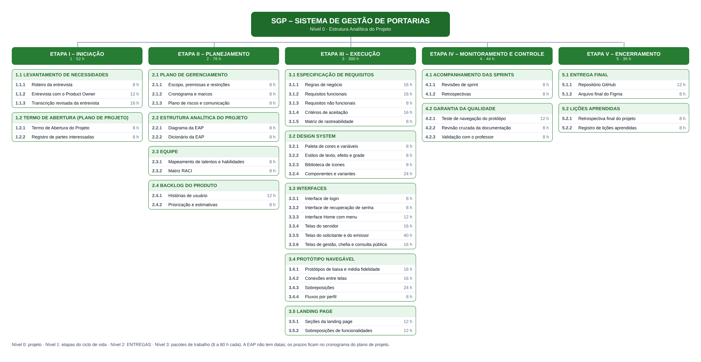

```mermaid
flowchart TD
    P["1 SGP – Sistema de Gestão de Portarias"]

    P --> G["1.1 Gerenciamento do projeto"]
    P --> L["1.2 Levantamento e análise"]
    P --> D["1.3 Design system"]
    P --> I["1.4 Interfaces"]
    P --> T["1.5 Prototipação navegável"]
    P --> E["1.6 Entrega"]

    G --> G1["1.1.1 Plano de projeto"]
    G --> G2["1.1.2 Backlog e sprints"]
    G --> G3["1.1.3 Mapeamento de talentos"]
    G --> G4["1.1.4 Riscos e comunicação"]

    L --> L1["1.2.1 Entrevista com o cliente"]
    L --> L2["1.2.2 Transcrição e análise"]
    L --> L3["1.2.3 Regras de negócio"]
    L --> L4["1.2.4 Requisitos funcionais e não funcionais"]
    L --> L5["1.2.5 Critérios de aceitação"]

    D --> D1["1.3.1 Paleta e variáveis"]
    D --> D2["1.3.2 Estilos de texto, cor, efeito e grade"]
    D --> D3["1.3.3 Biblioteca de ícones"]
    D --> D4["1.3.4 Componentes e variantes"]

    I --> I1["1.4.1 Landing page"]
    I --> I2["1.4.2 Login"]
    I --> I3["1.4.3 Recuperação de senha"]
    I --> I4["1.4.4 Home com menu"]
    I --> I5["1.4.5 Telas do servidor"]
    I --> I6["1.4.6 Telas do solicitante e do emissor"]
    I --> I7["1.4.7 Telas de gestão e chefia"]
    I --> I8["1.4.8 Consulta pública"]

    T --> T1["1.5.1 Conexões entre telas"]
    T --> T2["1.5.2 Sobreposições"]
    T --> T3["1.5.3 Componentes interativos"]
    T --> T4["1.5.4 Fluxos iniciais"]
    T --> T5["1.5.5 Teste de navegação"]

    E --> E1["1.6.1 Repositório GitHub"]
    E --> E2["1.6.2 Compartilhamento do Figma"]
    E --> E3["1.6.3 Revisão final"]
```

# 02 – EAP (Estrutura Analítica do Projeto)

<<<<<<< HEAD
A EAP decompõe **todo o escopo** do projeto em entregas, do nível 0 (o projeto) até os pacotes de trabalho (nível 3). Ela responde à pergunta “o que precisa ser produzido?” e, por isso, **não tem datas**: os prazos de cada pacote estão no [cronograma do planejamento detalhado](01b-planejamento-detalhado.md#6-cronograma).

## Regras seguidas

| Regra | Como foi aplicada |
|---|---|
| Orientação a entregas | Todos os elementos são substantivos (“Matriz RACI”, não “Fazer a matriz RACI”) |
| Nível 1 = ciclo de vida | Iniciação, Planejamento, Execução, Monitoramento e controle, Encerramento (PMI) |
| Padrão de escrita | ETAPAS e ENTREGAS em maiúsculas; pacotes de trabalho com a primeira letra maiúscula |
| Regra dos 100% | A soma dos filhos cobre todo o trabalho do pai; o que não está na EAP não faz parte do escopo |
| Regra 8-80 | Todo pacote de trabalho exige entre 8 e 80 horas de esforço |
| Sem filho único | Nenhum elemento é decomposto em um único componente |
| Pacotes independentes | Cada pacote pertence a um único pai, sem sobreposição de escopo |
| Gerenciamento incluído | Plano, EAP, equipe, backlog, acompanhamento e lições aprendidas também são entregas |

## Diagrama

```mermaid
flowchart TD
    P["SGP – SISTEMA DE GESTÃO DE PORTARIAS"]
    P --> E1["ETAPA I – INICIAÇÃO"]
    E1 --> D1_1["1.1 LEVANTAMENTO DE NECESSIDADES"]
    E1 --> D1_2["1.2 TERMO DE ABERTURA (PLANO DE PROJETO)"]
    P --> E2["ETAPA II – PLANEJAMENTO"]
    E2 --> D2_1["2.1 PLANO DE GERENCIAMENTO"]
    E2 --> D2_2["2.2 ESTRUTURA ANALÍTICA DO PROJETO"]
    E2 --> D2_3["2.3 EQUIPE"]
    E2 --> D2_4["2.4 BACKLOG DO PRODUTO"]
    P --> E3["ETAPA III – EXECUÇÃO"]
    E3 --> D3_1["3.1 ESPECIFICAÇÃO DE REQUISITOS"]
    E3 --> D3_2["3.2 DESIGN SYSTEM"]
    E3 --> D3_3["3.3 INTERFACES"]
    E3 --> D3_4["3.4 PROTÓTIPO NAVEGÁVEL"]
    E3 --> D3_5["3.5 LANDING PAGE"]
    P --> E4["ETAPA IV – MONITORAMENTO E CONTROLE"]
    E4 --> D4_1["4.1 ACOMPANHAMENTO DAS SPRINTS"]
    E4 --> D4_2["4.2 GARANTIA DA QUALIDADE"]
    P --> E5["ETAPA V – ENCERRAMENTO"]
    E5 --> D5_1["5.1 ENTREGA FINAL"]
    E5 --> D5_2["5.2 LIÇÕES APRENDIDAS"]
```

## Resumo do esforço

| Etapa | Entregas | Pacotes | Esforço estimado |
|---|---|---|---|
| 1 INICIAÇÃO | 2 | 5 | 52 h |
| 2 PLANEJAMENTO | 4 | 9 | 76 h |
| 3 EXECUÇÃO | 5 | 21 | 300 h |
| 4 MONITORAMENTO E CONTROLE | 2 | 5 | 44 h |
| 5 ENCERRAMENTO | 2 | 4 | 36 h |
| **Total** | **15** | **44** | **508 h** |

Esforço por responsável: Lucas Duarte Lopes 160 h · Willighan Tinelli de Souza 156 h · Victor Casagrande 148 h · Equipe 44 h. Os pacotes da “Equipe” são feitos pelos três juntos.

## Dicionário da EAP

Siglas: **VC** Victor Casagrande · **LD** Lucas Duarte Lopes · **WT** Willighan Tinelli de Souza · **Equipe** os três integrantes.

### 1 ETAPA I – INICIAÇÃO

**1.1 LEVANTAMENTO DE NECESSIDADES**

| Código | Pacote de trabalho | Descrição | Resp. | Estimativa | Critério de aceitação | Depende de |
|---|---|---|---|---|---|---|
| 1.1.1 | Roteiro da entrevista | Perguntas baseadas no checklist de entrevista da disciplina (contexto, perfis, processo atual, regras, exceções, integrações, melhorias). | VC | 8 h | Roteiro cobre as 11 seções do checklist e foi revisado pela equipe | — |
| 1.1.2 | Entrevista com o Product Owner | Entrevista gravada com o Diretor-Geral em 30/03/2026 e anotações no quadro do Miro. | Equipe | 12 h | Gravação e anotações disponíveis; todos os integrantes participaram | 1.1.1 |
| 1.1.3 | Transcrição revisada da entrevista | Transcrição com marcação de horário, usada como fonte dos requisitos. | VC | 16 h | Trechos citados nos requisitos conferidos com o áudio | 1.1.2 |

**1.2 TERMO DE ABERTURA (PLANO DE PROJETO)**

| Código | Pacote de trabalho | Descrição | Resp. | Estimativa | Critério de aceitação | Depende de |
|---|---|---|---|---|---|---|
| 1.2.1 | Termo de Abertura do Projeto | Artefato “Plano de Projeto” do enunciado, no modelo da disciplina: objetivos, requisitos de alto nível, entregas, exclusões, recursos, marcos, riscos e critérios de aceitação. | WT | 8 h | Todos os campos do modelo preenchidos e aprovados pela equipe | 1.1.3 |
| 1.2.2 | Registro de partes interessadas | Partes interessadas classificadas em equipe, clientes e outras partes, com interesse e perfil no sistema. | WT | 8 h | Toda parte citada na entrevista aparece no registro | 1.1.3 |

### 2 ETAPA II – PLANEJAMENTO

**2.1 PLANO DE GERENCIAMENTO**

| Código | Pacote de trabalho | Descrição | Resp. | Estimativa | Critério de aceitação | Depende de |
|---|---|---|---|---|---|---|
| 2.1.1 | Escopo, premissas e restrições | Objetivos SMART, o que está dentro e fora do escopo, premissas e restrições. | WT | 8 h | Escopo coerente com o Termo de Abertura e com a EAP | 1.2.1 |
| 2.1.2 | Cronograma e marcos | Fases, sprints semanais, cronograma de marcos e gráfico de Gantt. | WT | 8 h | Todos os marcos com data; entrega final em 08/11/2026 | 2.1.1, 2.2.1 |
| 2.1.3 | Plano de riscos e comunicação | Riscos com probabilidade, impacto e resposta; canais e rituais de comunicação. | WT | 8 h | Cada risco tem resposta definida | 2.1.1 |

**2.2 ESTRUTURA ANALÍTICA DO PROJETO**

| Código | Pacote de trabalho | Descrição | Resp. | Estimativa | Critério de aceitação | Depende de |
|---|---|---|---|---|---|---|
| 2.2.1 | Diagrama da EAP | Decomposição hierárquica orientada a entregas, do nível 0 ao nível 3. | WT | 8 h | Regra dos 100% atendida; nenhum elemento com um único filho | 2.1.1 |
| 2.2.2 | Dicionário da EAP | Código, descrição, responsável, estimativa, critérios de aceitação e dependências de cada pacote. | WT | 8 h | Todo pacote entre 8 e 80 horas | 2.2.1 |

**2.3 EQUIPE**

| Código | Pacote de trabalho | Descrição | Resp. | Estimativa | Critério de aceitação | Depende de |
|---|---|---|---|---|---|---|
| 2.3.1 | Mapeamento de talentos e habilidades | Competências exigidas, matriz de habilidades preenchida por cada integrante e alocação. | Equipe | 8 h | Os três integrantes preencheram a própria coluna | 1.2.1 |
| 2.3.2 | Matriz RACI | Responsável, aprovador, consultado e informado de cada entregável. | WT | 8 h | Toda entrega tem um único A | 2.3.1, 2.2.1 |

**2.4 BACKLOG DO PRODUTO**

| Código | Pacote de trabalho | Descrição | Resp. | Estimativa | Critério de aceitação | Depende de |
|---|---|---|---|---|---|---|
| 2.4.1 | Histórias de usuário | Histórias no formato Como/quero/para, ligadas aos requisitos. | VC | 12 h | Todo RF está coberto por ao menos uma história | 3.1.2 |
| 2.4.2 | Priorização e estimativas | Prioridade MoSCoW e estimativa em pontos de cada história. | VC | 8 h | Toda história tem prioridade e estimativa | 2.4.1 |

### 3 ETAPA III – EXECUÇÃO

**3.1 ESPECIFICAÇÃO DE REQUISITOS**

| Código | Pacote de trabalho | Descrição | Resp. | Estimativa | Critério de aceitação | Depende de |
|---|---|---|---|---|---|---|
| 3.1.1 | Regras de negócio | RN01–RN09 com fonte na entrevista, regras atômicas e tabelas de decisão. | VC | 16 h | Cada regra tem condição, ação e fonte | 1.1.3 |
| 3.1.2 | Requisitos funcionais | RF01–RF16 com prioridade e fonte. | VC | 16 h | Cada RF responde “o que o sistema faz” e tem fonte | 3.1.1 |
| 3.1.3 | Requisitos não funcionais | RNF01–RNF07 mensuráveis, classificados pela ISO/IEC 25010. | VC | 8 h | Todo RNF tem métrica verificável | 3.1.1 |
| 3.1.4 | Critérios de aceitação | Critérios do projeto, cenários Dado/Quando/Então e Definição de Pronto. | VC | 16 h | Todo RF e as três interfaces obrigatórias têm cenários | 3.1.2, 3.1.3 |
| 3.1.5 | Matriz de rastreabilidade | Ligação entre requisito, tela, história e critério de aceitação. | WT | 8 h | Nenhum requisito sem tela ou critério (exceto fase futura) | 3.1.4, 3.3 |

**3.2 DESIGN SYSTEM**

| Código | Pacote de trabalho | Descrição | Resp. | Estimativa | Critério de aceitação | Depende de |
|---|---|---|---|---|---|---|
| 3.2.1 | Paleta de cores e variáveis | Coleção de variáveis e 16 estilos de cor ligados a ela. | LD | 8 h | Estilos de cor visíveis no painel Assets | — |
| 3.2.2 | Estilos de texto, efeito e grade | 11 estilos de texto, 4 de efeito e 3 de grade. | LD | 8 h | Telas sem valores soltos de fonte e sombra | 3.2.1 |
| 3.2.3 | Biblioteca de ícones | 34 ícones em componentes. | WT | 8 h | Ícones usados apenas por instância | — |
| 3.2.4 | Componentes e variantes | Botão, Status, Campo de texto, Segmento, Card, Item de menu, Menu lateral, Barra superior e Cabeçalho, com propriedades e estados interativos. | LD | 24 h | Componentes usados em todas as telas | 3.2.1, 3.2.2, 3.2.3 |

**3.3 INTERFACES**

| Código | Pacote de trabalho | Descrição | Resp. | Estimativa | Critério de aceitação | Depende de |
|---|---|---|---|---|---|---|
| 3.3.1 | Interface de login | Estados padrão, erro e carregando. | LD | 8 h | Critérios CA-L1 a CA-L6 | 3.2.4 |
| 3.3.2 | Interface de recuperação de senha | Quatro telas: pedir link, link enviado, nova senha, senha alterada. | WT | 8 h | Critérios CA-R1 a CA-R6 | 3.2.4 |
| 3.3.3 | Interface Home com menu | Painel inicial com menu lateral por perfil, barra superior e pendências. | LD | 12 h | Critérios CA-H1 a CA-H6 | 3.2.4 |
| 3.3.4 | Telas do servidor | Carga horária, alertas, ciência e extrato. | WT | 16 h | Dados coerentes com a Home | 3.3.3 |
| 3.3.5 | Telas do solicitante e do emissor | Solicitação, fila, busca, detalhe, nova portaria em 6 etapas, pedido de exceção de carga horária, alterar, prorrogar, retificar, revogar e Boletim de Serviço. | LD | 40 h | Critérios CA-01 a CA-15 e CA-23 a CA-24 | 3.3.3 |
| 3.3.6 | Telas de gestão, chefia e consulta pública | Relatórios completos, aprovação de exceção de carga horária, relatórios do setor e consulta sem login. | VC | 16 h | Critérios CA-19, CA-21, CA-22 e CA-26 | 3.3.3 |

**3.4 PROTÓTIPO NAVEGÁVEL**

| Código | Pacote de trabalho | Descrição | Resp. | Estimativa | Critério de aceitação | Depende de |
|---|---|---|---|---|---|---|
| 3.4.1 | Protótipos de baixa e média fidelidade | Esboços no Miro e primeiras telas no Figma, feitos em Engenharia de Software I. | Equipe | 16 h | Versões preservadas e citadas no histórico | 1.1.3 |
| 3.4.2 | Conexões entre telas | Menu, botões, links, breadcrumbs e linhas de tabela ligados. | WT | 16 h | Nenhum elemento clicável sem destino | 3.3 |
| 3.4.3 | Sobreposições | Modais, menus do usuário e de ações, listas de seleção, pedido de exceção e avisos. | LD | 24 h | Todas abrem e fecham | 3.4.2 |
| 3.4.4 | Fluxos por perfil | Pontos de partida do protótipo, um por perfil ou cenário. | WT | 8 h | 9 fluxos listados no modo Apresentar, cada perfil começando no próprio login | 3.4.2 |

**3.5 LANDING PAGE**

| Código | Pacote de trabalho | Descrição | Resp. | Estimativa | Critério de aceitação | Depende de |
|---|---|---|---|---|---|---|
| 3.5.1 | Seções da landing page | Cabeçalho, hero, funcionalidades, confiança, antes e depois, chamada final e rodapé. | LD | 12 h | Critérios CA-LP1 a CA-LP6 | 3.2.4 |
| 3.5.2 | Sobreposições de funcionalidades | 12 janelas com descrição, perfis, passos e regra de negócio. | VC | 12 h | Navegação anterior/próxima e fechar em todas | 3.5.1, 3.1.1 |

### 4 ETAPA IV – MONITORAMENTO E CONTROLE

**4.1 ACOMPANHAMENTO DAS SPRINTS**

| Código | Pacote de trabalho | Descrição | Resp. | Estimativa | Critério de aceitação | Depende de |
|---|---|---|---|---|---|---|
| 4.1.1 | Revisões de sprint | Itens aceitos ou devolvidos pelo PO a cada semana. | LD | 8 h | Registro de cada revisão | 2.4.2 |
| 4.1.2 | Retrospectivas | Uma melhoria de processo por sprint. | LD | 8 h | Registro de cada retrospectiva | 4.1.1 |

**4.2 GARANTIA DA QUALIDADE**

| Código | Pacote de trabalho | Descrição | Resp. | Estimativa | Critério de aceitação | Depende de |
|---|---|---|---|---|---|---|
| 4.2.1 | Teste de navegação do protótipo | Percorrer os 9 fluxos por quem não desenhou as telas. | VC | 12 h | Checklist de 08 completo e sem links quebrados | 3.4.4 |
| 4.2.2 | Revisão cruzada da documentação | Conferência entre Figma e documentos: nomes, números e regras. | WT | 8 h | Nenhuma divergência pendente | 3.1.5 |
| 4.2.3 | Validação com o professor | Apresentação do protótipo e registro das respostas às questões em aberto. | VC | 8 h | Ajustes decorrentes aplicados | 4.2.1 |

### 5 ETAPA V – ENCERRAMENTO

**5.1 ENTREGA FINAL**

| Código | Pacote de trabalho | Descrição | Resp. | Estimativa | Critério de aceitação | Depende de |
|---|---|---|---|---|---|---|
| 5.1.1 | Repositório GitHub | Documentação em Markdown e imagens, com acesso do professor. | WT | 12 h | Repositório acessível e completo | 4.2.2 |
| 5.1.2 | Arquivo final do Figma | Arquivo organizado, renomeado e compartilhado com edição. | LD | 8 h | Acesso de edição confirmado para tiago.goncalves@ifc.edu.br | 4.2.1 |

**5.2 LIÇÕES APRENDIDAS**

| Código | Pacote de trabalho | Descrição | Resp. | Estimativa | Critério de aceitação | Depende de |
|---|---|---|---|---|---|---|
| 5.2.1 | Retrospectiva final do projeto | Reunião sobre o que funcionou e o que mudar no próximo projeto. | Equipe | 8 h | Registro com ao menos três lições | 5.1 |
| 5.2.2 | Registro de lições aprendidas | Documento com as lições, publicado no repositório. | WT | 8 h | Publicado antes de 08/11/2026, 23h59 | 5.2.1 |

## Recursos

Os recursos não aparecem na EAP; eles são alocados aos pacotes:

- **Pessoas:** os três integrantes (ver [03 – Mapeamento de talentos](03-mapeamento-de-talentos.md)).
- **Ferramentas:** Figma (plano Education), Miro, GitHub, gravador de áudio e editor de texto.
- **Cliente:** disponibilidade do Diretor-Geral para a entrevista e para dúvidas.
=======
A EAP decompõe o trabalho em entregáveis. Cada pacote de trabalho (último nível) tem um responsável e um critério de conclusão no dicionário abaixo.

## Diagrama

## Dicionário da EAP

Siglas dos responsáveis: **VC** Victor Casagrande · **LD** Lucas Duarte Lopes · **WT** Willighan Tinelli de Souza.

### 1.1 Gerenciamento do projeto

| Código | Pacote | Descrição | Critério de conclusão | Resp. | Sprint |
|---|---|---|---|---|---|
| 1.1.1 | Plano de projeto | Escopo, partes interessadas, metodologia, cronograma | `docs/01` revisado pelos três integrantes | LD | 1 |
| 1.1.2 | Backlog e sprints | Histórias de usuário priorizadas e sprints semanais | Backlog com prioridade, estimativa e sprint | VC | 1 |
| 1.1.3 | Mapeamento de talentos | Competências, matriz de habilidades e RACI | `docs/03` preenchido por todos | LD | 1–2 |
| 1.1.4 | Riscos e comunicação | Riscos com resposta; ferramentas e rituais | Tabela de riscos no plano | LD | 1 |

### 1.2 Levantamento e análise

| Código | Pacote | Descrição | Critério de conclusão | Resp. | Sprint |
|---|---|---|---|---|---|
| 1.2.1 | Entrevista com o cliente | Entrevista gravada com o Diretor-Geral | Gravação e resumo disponíveis | Equipe | 0 |
| 1.2.2 | Transcrição e análise | Transcrição revisada e conferência do resumo em PDF com o áudio | Transcrição em `anexos/` | VC | 1 |
| 1.2.3 | Regras de negócio | RN01–RN09 com fonte na entrevista | `docs/06` e página Requisitos do Figma | LD | 1 |
| 1.2.4 | Requisitos funcionais e não funcionais | RF01–RF15 e RNF01–RNF07 com rastreabilidade | `docs/05` e página Requisitos do Figma | LD | 1 |
| 1.2.5 | Critérios de aceitação | Cenários Dado/Quando/Então e Definição de Pronto | `docs/04` cobre todos os RF e as três interfaces obrigatórias | WT | 1 |

### 1.3 Design system

| Código | Pacote | Descrição | Critério de conclusão | Resp. | Sprint |
|---|---|---|---|---|---|
| 1.3.1 | Paleta e variáveis | Coleção “SGP Tokens” com cores de marca, estados, fundos, bordas e textos | Variáveis criadas e usadas nas telas | VC | 0–1 |
| 1.3.2 | Estilos | 11 estilos de texto, 16 de cor (ligados às variáveis), 4 de efeito e 3 de grade | Estilos visíveis no painel Assets e aplicados nas telas | VC | 1 |
| 1.3.3 | Biblioteca de ícones | Ícones em componentes, com nomes `Icon/…` | Ícones usados por instância, sem cópias soltas | WT | 0–1 |
| 1.3.4 | Componentes e variantes | Botão, Status, Campo de texto, Segmento, Card, Item de menu, Menu lateral, Barra superior, Cabeçalho | Componentes com propriedades e variantes usados em todas as telas | VC | 1 |

### 1.4 Interfaces

| Código | Pacote | Descrição | Critério de conclusão | Resp. | Sprint |
|---|---|---|---|---|---|
| 1.4.1 | Landing page | Apresentação, funcionalidades, confiança, antes e depois, rodapé | Tela “Landing” completa | VC | 0–1 |
| 1.4.2 | Login | Estados padrão, erro e carregando | Três telas de login | VC | 1 |
| 1.4.3 | Recuperação de senha | Pedir link, link enviado, nova senha, senha alterada | Quatro telas conectadas | WT | 1 |
| 1.4.4 | Home com menu | Painel inicial com menu lateral, barra superior e pendências | Tela “Painel – Início” | VC | 1 |
| 1.4.5 | Telas do servidor | Carga horária, alertas, ciência, extrato | Quatro telas | WT | 1 |
| 1.4.6 | Telas do solicitante e do emissor | Solicitação, fila, busca, detalhe, nova portaria em 6 etapas, alterar, retificar, revogar, Boletim | Telas completas e coerentes entre si | VC, WT | 1 |
| 1.4.7 | Telas de gestão e chefia | Relatórios completos e relatórios do setor | Duas telas, com restrição de acesso indicada | LD | 1 |
| 1.4.8 | Consulta pública | Busca e detalhe sem login | Duas telas sem CPF ou dados sensíveis | LD | 1 |

### 1.5 Prototipação navegável

| Código | Pacote | Descrição | Critério de conclusão | Resp. | Sprint |
|---|---|---|---|---|---|
| 1.5.1 | Conexões entre telas | Menu, botões, links e breadcrumbs ligados | Nenhum elemento clicável sem destino (exceto os intencionais) | WT | 1 |
| 1.5.2 | Sobreposições | 12 modais de funcionalidade, menus do usuário e de ações, 23 listas de seleção, avisos (toasts) e modal de membro externo | Todas abrem e fecham | WT | 1 |
| 1.5.3 | Componentes interativos | Hover em cards e botões; segmentos alternando ao clicar | Variantes interativas configuradas | VC | 1 |
| 1.5.4 | Fluxos iniciais | 10 fluxos, um por perfil ou cenário | Fluxos listados no modo Apresentar | WT | 1 |
| 1.5.5 | Teste de navegação | Percorrer cada fluxo do início ao fim | Checklist de `docs/08` completo, sem links quebrados | LD | 3 |

### 1.6 Entrega

| Código | Pacote | Descrição | Critério de conclusão | Resp. | Sprint |
|---|---|---|---|---|---|
| 1.6.1 | Repositório GitHub | Documentos em Markdown e imagens das telas | Repositório público com README e `docs/` | LD | 4 |
| 1.6.2 | Compartilhamento do Figma | Permissão de edição para `tiago.goncalves@ifc.edu.br` | Acesso confirmado | VC | 2 |
| 1.6.3 | Revisão final | Revisão cruzada de documentos e telas | Checklist de entrega assinado pelos três | Equipe | 4 |
>>>>>>> d6bbe2420940a307e4281d6f372dfda392b37881
