# 02 – EAP (Estrutura Analítica do Projeto)

A EAP decompõe o trabalho em entregáveis. Cada pacote de trabalho (último nível) tem um responsável e um critério de conclusão no dicionário abaixo.

## Diagrama

```mermaid
flowchart TD
    P["1 SGP – Sistema de Gestão de Portarias"]

    P --> G["1.1 Gerenciamento do projeto"]
    P --> L["1.2 Levantamento e análise"]
    P --> D["1.3 Design system"]
    P --> I["1.4 Interfaces"]
    P --> T["1.5 Prototipação navegável"]
    P --> E["1.6 Entrega"]

    G --> G1["1.1.1 Plano de projeto"]
    G --> G2["1.1.2 Backlog e sprints"]
    G --> G3["1.1.3 Mapeamento de talentos"]
    G --> G4["1.1.4 Riscos e comunicação"]

    L --> L1["1.2.1 Entrevista com o cliente"]
    L --> L2["1.2.2 Transcrição e análise"]
    L --> L3["1.2.3 Regras de negócio"]
    L --> L4["1.2.4 Requisitos funcionais e não funcionais"]
    L --> L5["1.2.5 Critérios de aceitação"]

    D --> D1["1.3.1 Paleta e variáveis"]
    D --> D2["1.3.2 Estilos de texto, cor, efeito e grade"]
    D --> D3["1.3.3 Biblioteca de ícones"]
    D --> D4["1.3.4 Componentes e variantes"]

    I --> I1["1.4.1 Landing page"]
    I --> I2["1.4.2 Login"]
    I --> I3["1.4.3 Recuperação de senha"]
    I --> I4["1.4.4 Home com menu"]
    I --> I5["1.4.5 Telas do servidor"]
    I --> I6["1.4.6 Telas do solicitante e do emissor"]
    I --> I7["1.4.7 Telas de gestão e chefia"]
    I --> I8["1.4.8 Consulta pública"]

    T --> T1["1.5.1 Conexões entre telas"]
    T --> T2["1.5.2 Sobreposições"]
    T --> T3["1.5.3 Componentes interativos"]
    T --> T4["1.5.4 Fluxos iniciais"]
    T --> T5["1.5.5 Teste de navegação"]

    E --> E1["1.6.1 Repositório GitHub"]
    E --> E2["1.6.2 Compartilhamento do Figma"]
    E --> E3["1.6.3 Revisão final"]
```

## Dicionário da EAP

Siglas dos responsáveis: **VC** Victor Casagrande · **LD** Lucas Duarte Lopes · **WT** Willighan Tinelli de Souza.

### 1.1 Gerenciamento do projeto

| Código | Pacote | Descrição | Critério de conclusão | Resp. | Sprint |
|---|---|---|---|---|---|
| 1.1.1 | Plano de projeto | Escopo, partes interessadas, metodologia, cronograma | `docs/01` revisado pelos três integrantes | LD | 1 |
| 1.1.2 | Backlog e sprints | Histórias de usuário priorizadas e sprints semanais | Backlog com prioridade, estimativa e sprint | VC | 1 |
| 1.1.3 | Mapeamento de talentos | Competências, matriz de habilidades e RACI | `docs/03` preenchido por todos | LD | 1–2 |
| 1.1.4 | Riscos e comunicação | Riscos com resposta; ferramentas e rituais | Tabela de riscos no plano | LD | 1 |

### 1.2 Levantamento e análise

| Código | Pacote | Descrição | Critério de conclusão | Resp. | Sprint |
|---|---|---|---|---|---|
| 1.2.1 | Entrevista com o cliente | Entrevista gravada com o Diretor-Geral | Gravação e resumo disponíveis | Equipe | 0 |
| 1.2.2 | Transcrição e análise | Transcrição revisada e conferência do resumo em PDF com o áudio | Transcrição em `anexos/` | VC | 1 |
| 1.2.3 | Regras de negócio | RN01–RN09 com fonte na entrevista | `docs/06` e página Requisitos do Figma | LD | 1 |
| 1.2.4 | Requisitos funcionais e não funcionais | RF01–RF15 e RNF01–RNF07 com rastreabilidade | `docs/05` e página Requisitos do Figma | LD | 1 |
| 1.2.5 | Critérios de aceitação | Cenários Dado/Quando/Então e Definição de Pronto | `docs/04` cobre todos os RF e as três interfaces obrigatórias | WT | 1 |

### 1.3 Design system

| Código | Pacote | Descrição | Critério de conclusão | Resp. | Sprint |
|---|---|---|---|---|---|
| 1.3.1 | Paleta e variáveis | Coleção “SGP Tokens” com cores de marca, estados, fundos, bordas e textos | Variáveis criadas e usadas nas telas | VC | 0–1 |
| 1.3.2 | Estilos | 11 estilos de texto, 16 de cor (ligados às variáveis), 4 de efeito e 3 de grade | Estilos visíveis no painel Assets e aplicados nas telas | VC | 1 |
| 1.3.3 | Biblioteca de ícones | Ícones em componentes, com nomes `Icon/…` | Ícones usados por instância, sem cópias soltas | WT | 0–1 |
| 1.3.4 | Componentes e variantes | Botão, Status, Campo de texto, Segmento, Card, Item de menu, Menu lateral, Barra superior, Cabeçalho | Componentes com propriedades e variantes usados em todas as telas | VC | 1 |

### 1.4 Interfaces

| Código | Pacote | Descrição | Critério de conclusão | Resp. | Sprint |
|---|---|---|---|---|---|
| 1.4.1 | Landing page | Apresentação, funcionalidades, confiança, antes e depois, rodapé | Tela “Landing” completa | VC | 0–1 |
| 1.4.2 | Login | Estados padrão, erro e carregando | Três telas de login | VC | 1 |
| 1.4.3 | Recuperação de senha | Pedir link, link enviado, nova senha, senha alterada | Quatro telas conectadas | WT | 1 |
| 1.4.4 | Home com menu | Painel inicial com menu lateral, barra superior e pendências | Tela “Painel – Início” | VC | 1 |
| 1.4.5 | Telas do servidor | Carga horária, alertas, ciência, extrato | Quatro telas | WT | 1 |
| 1.4.6 | Telas do solicitante e do emissor | Solicitação, fila, busca, detalhe, nova portaria em 6 etapas, alterar, retificar, revogar, Boletim | Telas completas e coerentes entre si | VC, WT | 1 |
| 1.4.7 | Telas de gestão e chefia | Relatórios completos e relatórios do setor | Duas telas, com restrição de acesso indicada | LD | 1 |
| 1.4.8 | Consulta pública | Busca e detalhe sem login | Duas telas sem CPF ou dados sensíveis | LD | 1 |

### 1.5 Prototipação navegável

| Código | Pacote | Descrição | Critério de conclusão | Resp. | Sprint |
|---|---|---|---|---|---|
| 1.5.1 | Conexões entre telas | Menu, botões, links e breadcrumbs ligados | Nenhum elemento clicável sem destino (exceto os intencionais) | WT | 1 |
| 1.5.2 | Sobreposições | 12 modais de funcionalidade, menus do usuário e de ações, 23 listas de seleção, avisos (toasts) e modal de membro externo | Todas abrem e fecham | WT | 1 |
| 1.5.3 | Componentes interativos | Hover em cards e botões; segmentos alternando ao clicar | Variantes interativas configuradas | VC | 1 |
| 1.5.4 | Fluxos iniciais | 10 fluxos, um por perfil ou cenário | Fluxos listados no modo Apresentar | WT | 1 |
| 1.5.5 | Teste de navegação | Percorrer cada fluxo do início ao fim | Checklist de `docs/08` completo, sem links quebrados | LD | 3 |

### 1.6 Entrega

| Código | Pacote | Descrição | Critério de conclusão | Resp. | Sprint |
|---|---|---|---|---|---|
| 1.6.1 | Repositório GitHub | Documentos em Markdown e imagens das telas | Repositório público com README e `docs/` | LD | 4 |
| 1.6.2 | Compartilhamento do Figma | Permissão de edição para `tiago.goncalves@ifc.edu.br` | Acesso confirmado | VC | 2 |
| 1.6.3 | Revisão final | Revisão cruzada de documentos e telas | Checklist de entrega assinado pelos três | Equipe | 4 |
