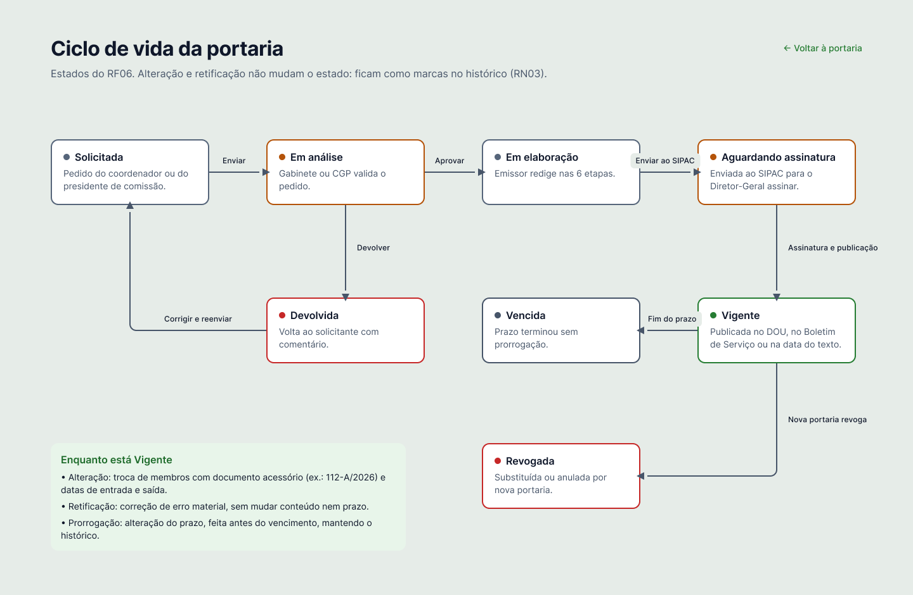
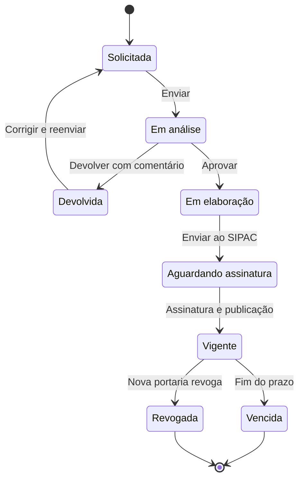

# 05 – Requisitos funcionais e não funcionais

Requisitos revisados com a gravação da entrevista com o Diretor-Geral do Campus Videira (versão 2). A mesma lista está na página **Requisitos** do Figma.

**Fontes:** “entrevista mm:ss” aponta o trecho da gravação; “PDF” indica o resumo escrito da entrevista; “professor (22/10/2026)” indica regra confirmada com o professor da disciplina; “proposta da equipe” marca o que não veio do cliente.
**Marcadores:** 🆕 requisito incluído na versão 2 a partir da gravação · 🔮 fase futura.
**Prioridade (MoSCoW):** M = obrigatório (o sistema não funciona sem ele) · S = importante, mas não vital · C = desejável · W = fora desta versão.

## Técnicas usadas

| Etapa | Técnica | Como foi aplicada |
|---|---|---|
| Descoberta | Entrevista estruturada | Entrevista gravada com o Product Owner em 30/03/2026, guiada pelo checklist de entrevista da disciplina |
| Descoberta | Análise de documentos | Boletins de Serviço do IFC, para a regra de vigência (RN02) |
| Validação | Validação com especialista | Dúvidas de regra de negócio confirmadas com o professor em 22/10/2026 ([decisões](01b-planejamento-detalhado.md#10-decisões-confirmadas-com-o-professor)) |
| Especificação | Histórias de usuário | Backlog no formato Como/quero/para ([plano, seção 8](01b-planejamento-detalhado.md#7-product-backlog)) |
| Especificação | BDD (Dado/Quando/Então) | Critérios de aceitação ([04](04-criterios-de-aceitacao.md)) |
| Especificação | Tabelas de decisão | Regras condicionais de vigência e carga horária ([06](06-regras-de-negocio.md#tabelas-de-decisão)) |
| Validação | Protótipo de alta fidelidade | Fluxos e regras visíveis na interface, navegáveis no Figma |

## Requisitos funcionais (RF)

| ID | Nome | Descrição | Prior. | Fonte | Regras |
|---|---|---|---|---|---|
| RF01 🆕 | Solicitação de portaria | O Solicitante informa o tipo do pedido (nova, alteração ou prorrogação), objetivo, justificativa, prazo e membros sugeridos, escolhendo os nomes na base. O pedido vai ao Emissor. | M | entrevista 42:56, 01:09:32 | RN05, RN07 |
| RF02 🆕 | Análise do pedido | O Emissor valida o pedido ou o devolve com comentário (ex.: falta justificativa). O Diretor revisa antes de assinar. | M | entrevista 01:10:28 | RN01 |
| RF03 | Elaboração guiada | Etapas obrigatórias: dados gerais, epígrafe e ementa, preâmbulo, corpo (artigos), membros e revisão. Edição livre só enquanto a portaria está em elaboração. | M | entrevista 29:52; PDF | RN01, RN02, RN08 |
| RF04 | Seleção de membros | Busca na base institucional, inclusão de externos, papel e horas por membro, com checagem da RN04 a cada inclusão e pedido de exceção quando o limite é ultrapassado (RF16). | M | entrevista 14:00, 38:44 | RN04, RN07 |
| RF05 | Integração com o SIPAC | Envio para formalização e assinatura; o status e o PDF assinado voltam automaticamente. Nenhum dado é digitado duas vezes. | M | entrevista 19:36, 01:10:56, 01:14:12 | RN02 |
| RF06 | Estados da portaria | Solicitada → Em análise (ou Devolvida) → Em elaboração → Aguardando assinatura → Vigente → Vencida ou Revogada. Alterações e retificações aparecem como marcas no histórico. | M | entrevista 35:56 | RN03, RN08 |
| RF07 🆕 | Alteração de membros e prazo | Troca de membros (quem sai e quem entra, com as datas) ou **prorrogação do prazo**. Gera documento acessório; o histórico guarda a versão anterior e o extrato mostra o período exato de cada pessoa. | M | entrevista 24:16–25:40; professor (22/10/2026) | RN03, RN08 |
| RF08 🆕 | Retificação e revogação | A retificação edita só o texto, com justificativa. A revogação cria uma nova portaria vinculada, com cláusula revogatória. | M | entrevista 26:08–27:04 | RN03, RN09 |
| RF09 | Motor de carga horária | Soma, por servidor, as horas das portarias vigentes e compara com a jornada e, para docentes, com o limite de 10 h. | M | entrevista 31:16, 47:08 | RN04 |
| RF10 | Alertas e ciência | Aviso de vencimento **de 7 a 5 dias antes**, a presidentes, chefias e Gabinete. Após a assinatura, os membros recebem um link para registrar “Estou ciente do teor”, com data e hora. | M | entrevista 07:00, 33:36, 01:11:24; professor (22/10/2026) | RN08 |
| RF11 🆕 | Busca e consulta pública | Filtros por servidor, tipo, órgão ou objeto (ex.: NDE), período de participação, ano, status e carga horária. Dados públicos consultáveis sem login. | M | entrevista 54:36–57:24 | RN06 |
| RF12 | Extrato curricular | Todas as portarias de um servidor, com período, papel e horas, para a progressão funcional. | M | entrevista 07:28, 54:36 | RN03, RN09 |
| RF13 | Relatórios gerenciais | Panorama de carga horária por servidor e setor; listagem histórica por objeto (ex.: quem foi fiscal do contrato X). | S | entrevista 31:16, 56:28 | RN05, RN06 |
| RF14 🆕 | Boletim de Serviço | Compilação mensal das portarias emitidas, pronta para publicação no site. | S | entrevista 13:32, 58:20 | RN02 |
| RF15 | Histórico da portaria | Janela com todas as alterações, retificações e revogações, com justificativa, autor, data e número do documento. | M | entrevista 35:56–36:24 | RN09 |
| RF16 🆕 | Exceção ao limite de carga horária | Quando uma inclusão ultrapassa o limite, o Emissor pede exceção com justificativa; o **DEP, o DAP ou o DG** aprova ou recusa **no próprio sistema**, e a decisão fica no histórico da portaria. | M | entrevista 47:36–48:04; professor (22/10/2026) | RN04 |

## Requisitos não funcionais (RNF)

Todo RNF é **mensurável**: a coluna “Métrica de aceitação” diz como verificar se ele foi atendido. A categoria segue as características de qualidade da **ISO/IEC 25010**.

| ID | Nome | Categoria ISO/IEC 25010 | Descrição | Métrica de aceitação | Fonte |
|---|---|---|---|---|---|
| RNF01 | Autenticação institucional | Segurança (autenticidade) e Compatibilidade (interoperabilidade) | Login via LDAP/AD da Reitoria. Nome (inclusive nome social), SIAPE, CPF, vínculo (docente ou TAE) e lotação vêm sempre do cadastro central. | 100% dos acessos validados no LDAP/AD; nenhum dado cadastral digitado no SGP | entrevista 37:20 |
| RNF02 | Dependência do SIPAC | Confiabilidade (tolerância a falhas) | Se o SIPAC estiver fora do ar, a assinatura fica suspensa. Não há fila offline. | Com o SIPAC indisponível, o envio é recusado com aviso ao usuário e nenhuma portaria muda de estado | entrevista 45:16 |
| RNF03 | Desempenho da busca | Eficiência de desempenho (comportamento no tempo) | A busca de membros mostra resultados enquanto o usuário digita, sem travar o preenchimento. | Resultados em até 1 segundo em 95% das buscas, com a base de servidores do campus | PDF; métrica proposta pela equipe |
| RNF04 | Integridade e auditoria | Segurança (integridade e responsabilização) | Dados permanentes. Toda ação registra quem fez, quando e o que mudou, visível no histórico da portaria. O endereço IP fica só nos registros técnicos do servidor. | 100% das ações de alteração com autor, data e hora no histórico; nenhuma exclusão de portaria assinada; IP em nenhuma tela | entrevista 36:24; proposta da equipe |
| RNF05 | Privacidade (LGPD) | Segurança (confidencialidade) | CPF e dados sensíveis visíveis apenas para Emissores, nunca em consultas públicas nem em relatórios. | CPF em 0 telas públicas e em 0 relatórios | entrevista 53:12 |
| RNF06 | Sem exportação para planilha | Restrição do cliente | O sistema substitui a planilha; não haverá exportação para manter planilhas paralelas. | Nenhuma opção de exportação em formato de planilha; exportações apenas em PDF | entrevista 01:09:04 |
| RNF07 🔮 | Legado (fase futura) | Portabilidade (adaptabilidade) | Importação das portarias de 2010 a 2016 a partir de planilhas e PDFs: desejável, mas não prioritária. | 100% das portarias do período importadas sem redigitação | entrevista 01:00:40 |

**Usabilidade (ISO/IEC 25010):** além dos RNF acima, o protótipo segue critérios de acessibilidade verificáveis: contraste mínimo de 4,5:1 entre texto e fundo (WCAG 2.1 AA) e erros sinalizados por cor, ícone e texto ao mesmo tempo (critério CA-N6).

## Matriz de rastreabilidade

Relaciona cada requisito às telas do protótipo, às histórias de usuário do [plano](01b-planejamento-detalhado.md#7-product-backlog) e aos critérios de aceitação de [04](04-criterios-de-aceitacao.md).

| Requisito | Telas no Figma | História | Critérios |
|---|---|---|---|
| RF01 | Solicitação – nova (solicitante) | US05 | CA-01, CA-02 |
| RF02 | Solicitações – fila do Emissor | US06 | CA-03, CA-04 |
| RF03 | Nova portaria – etapas 1 a 6 | US07 | CA-05, CA-06 |
| RF04 | Nova portaria – 5. Membros; Modal – Adicionar membro externo | US08 | CA-07, CA-08 |
| RF05 | Nova portaria – 6. Revisão e envio; Alterar membros | US09 | CA-09, CA-10 |
| RF06 | Diagrama – ciclo de vida; Portarias – busca; Portaria – detalhe | US10 | CA-11 |
| RF07 | Portaria 112/2026 – Alterar membros; Portaria 112/2026 – Prorrogar | US11 | CA-12, CA-13, CA-27 |
| RF08 | Portaria 112/2026 – Retificar; Portaria 112/2026 – Revogar | US12 | CA-14, CA-15 |
| RF09 | Painel – Carga horária; Nova portaria – 5. Membros | US08 | CA-16 |
| RF10 | Painel – Alertas; Ciência – Portaria 98/2026; Portaria – detalhe | US13 | CA-17, CA-18 |
| RF11 | Portarias – busca; Consulta pública – busca e detalhe | US14 | CA-19 |
| RF12 | Painel – Extrato curricular | US15 | CA-20 |
| RF13 | Relatórios – gestão; Relatórios – chefia de setor | US16 | CA-21, CA-22 |
| RF14 | Boletim de Serviço – setembro/2026 | US17 | CA-23 |
| RF15 | Portaria – detalhe (histórico de versões) | US18 | CA-24 |
| RF16 | Nova portaria – 5. Membros; Modal – Pedir exceção; Exceção de carga horária – aprovação (Gestão); Relatórios – gestão | US26, US27 | CA-25, CA-26 |
| RNF01 | Login – Padrão, Erro, Carregando; Recuperar senha 1 a 4 | US02, US03 | CA-L1 a CA-L6, CA-R1 a CA-R6, CA-N1 |
| RNF02 | Nova portaria – 6. Revisão e envio | US09 | CA-10 |
| RNF03 | Nova portaria – 5. Membros; Solicitação – nova | US08 | CA-N2 |
| RNF04 | Portaria – detalhe | US18 | CA-N3 |
| RNF05 | Consulta pública; Relatórios | US14, US16 | CA-19, CA-N4 |
| RNF06 | Extrato; Relatórios; Boletim (exportação só em PDF) | — | CA-N5 |
| RNF07 | — (fase futura) | US24 | — |

## Ciclo de vida da portaria (RF06)

Enquanto a portaria está **Vigente**, a alteração de membros (documento acessório) e a retificação não mudam o estado: ficam registradas como marcas no histórico (RN03).
