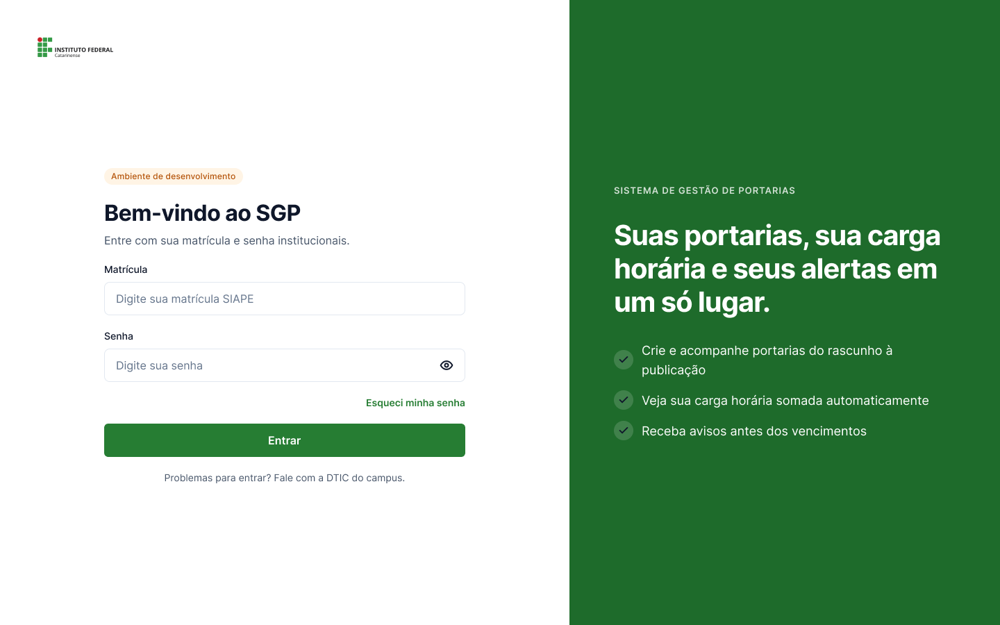
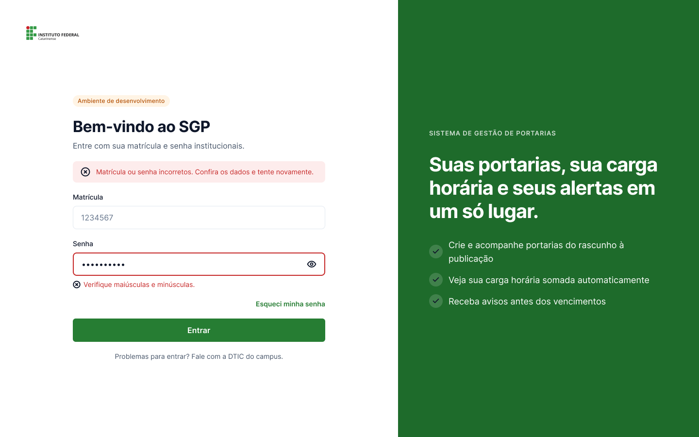
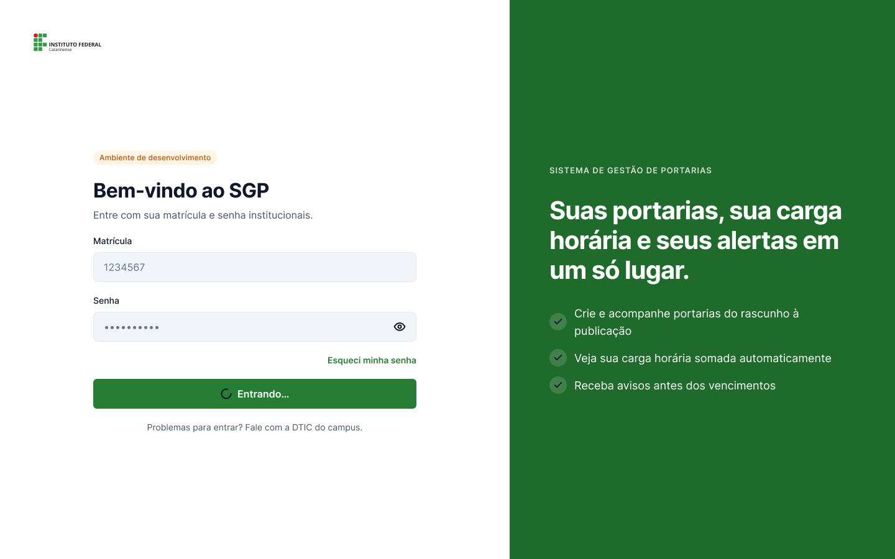
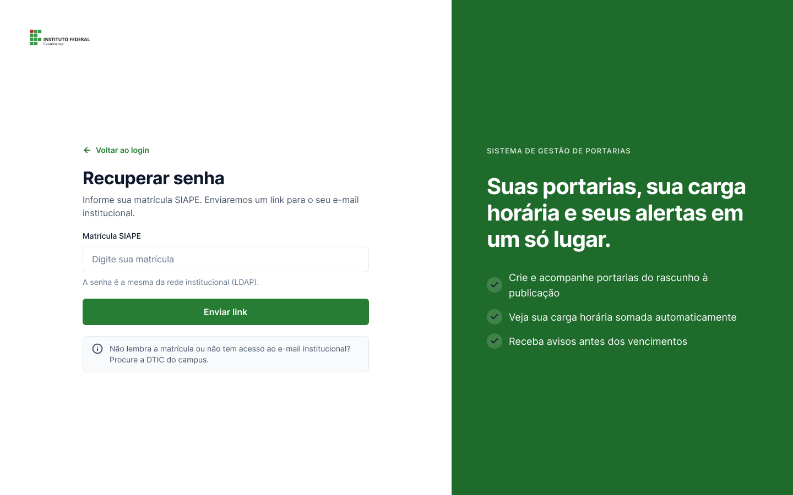
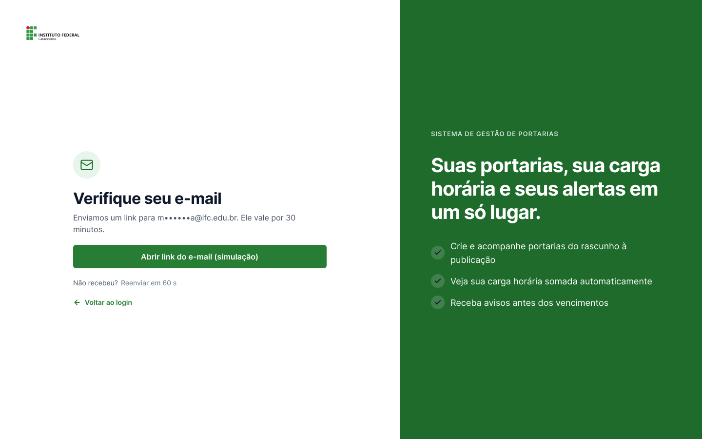
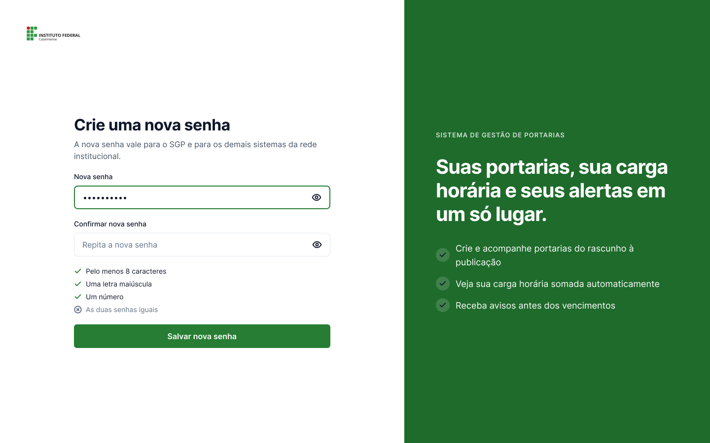
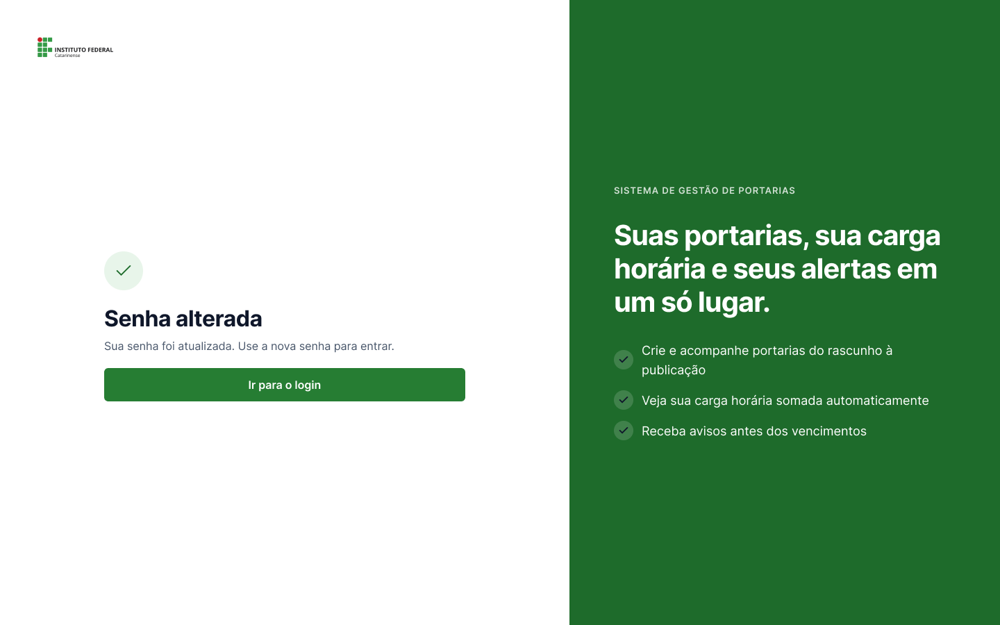
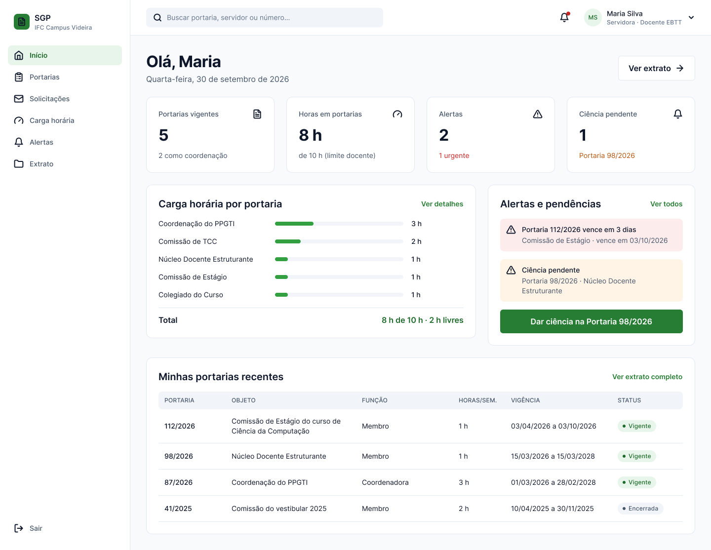

# 07 – Interfaces

As três interfaces exigidas no trabalho estão na página **Telas (protótipo)** do Figma, nas seções **Login** e **Painéis**. Todas usam a largura de 1440 px, a fonte Inter e os componentes e estilos descritos em [10 – Design system](10-design-system.md).

| Interface | Telas no Figma | Fluxo inicial do protótipo |
|---|---|---|
| a) Login com usuário e senha | Login – Padrão · Login – Erro · Login – Carregando | 1. Visitante · 3. Login com erro |
| b) Recuperação de senha | Recuperar senha – 1. Pedir link · 2. Link enviado · 3. Nova senha · 4. Senha alterada | 3b. Recuperar senha |
| c) Home com menu | Painel – Início | 4. Servidora: painel, alertas e ciência |

---

## a) Login com usuário e senha

**Objetivo:** autenticar o servidor com as credenciais institucionais. O **usuário é a matrícula SIAPE** e a **senha é a da rede institucional** (LDAP/AD da Reitoria, RNF01), sem cadastro próprio no SGP.

**Elementos**

| Elemento | Comportamento |
|---|---|
| Campo **Matrícula** | Recebe a matrícula SIAPE |
| Campo **Senha** | Oculta por padrão; o ícone de olho mostra ou esconde a senha |
| **Esqueci minha senha** | Abre a recuperação de senha (interface b) |
| Botão **Entrar** | Mostra o estado “Entrando…” e depois abre a Home |
| “Problemas para entrar? Fale com a DTIC do campus.” | Orientação de suporte |
| Painel verde à direita | Resume o que o SGP oferece |

**Decisões de projeto**

- **Não há seletor de perfil.** O perfil (Servidor, Solicitante, Emissor, Chefia, Gestão) vem do cadastro, e um usuário pode acumular perfis (RN05).

### Estado de erro

A mensagem geral aparece no topo do formulário; o campo de senha fica com borda vermelha e uma dica específica (“Verifique maiúsculas e minúsculas.”). O erro é sinalizado por cor, ícone e texto ao mesmo tempo, para não depender só da cor.

### Estado carregando

O botão mostra “Entrando…” enquanto o LDAP responde, evitando cliques repetidos. No protótipo, a tela avança sozinha para a Home.

---

## b) Recuperação de senha

Fluxo em quatro telas. Como a senha é a do LDAP, a troca vale para todos os sistemas institucionais.

| 1. Pedir link | 2. Link enviado |
|---|---|
|  |  |
| **3. Nova senha** | **4. Senha alterada** |
|  |  |

| Tela | O que o usuário faz | Detalhes |
|---|---|---|
| 1. Pedir link | Informa a matrícula SIAPE e clica em **Enviar link** | Lembra que a senha é a da rede institucional; orienta procurar a DTIC se não tiver acesso ao e-mail |
| 2. Link enviado | Abre o link recebido no e-mail institucional | O e-mail aparece parcialmente oculto (m••••••a@ifc.edu.br); o link vale 30 minutos; reenvio liberado após 60 s. No protótipo, o botão “Abrir link do e-mail (simulação)” leva à tela 3 |
| 3. Nova senha | Digita e confirma a nova senha | Checklist em tempo real: 8 caracteres, uma maiúscula, um número e as duas senhas iguais |
| 4. Senha alterada | Clica em **Ir para o login** | Confirmação e retorno ao login |

**Decisões de projeto**

- O pedido é feito pela matrícula, não pelo e-mail, porque o servidor sempre sabe a própria matrícula, e o e-mail institucional é buscado no cadastro.
- **Voltar ao login** está disponível nas telas 1 e 2.

---

## c) Home com menu

**Objetivo:** mostrar ao servidor, logo ao entrar, a situação das suas portarias e o que precisa de ação. O exemplo é a servidora **Maria Silva**, docente EBTT e coordenadora do PPGTI.

**Estrutura**

| Região | Conteúdo |
|---|---|
| **Menu lateral** (componente `Menu lateral`) | Início, Portarias, Solicitações, Carga horária, Alertas, Extrato e Sair. O item atual fica destacado. **Nova portaria** só aparece para Emissores e **Relatórios** só para Gestão e Chefias (RN05) |
| **Barra superior** (componente `Barra superior`) | Busca global (leva à busca de portarias), sino de notificações com indicador (leva aos alertas) e menu do usuário: nome, SIAPE, troca entre os perfis que a pessoa acumula (ex.: Servidor e Solicitante), Meu extrato e Sair |
| **Cabeçalho** | Saudação, data e atalho **Ver extrato** |
| **Indicadores** | Portarias vigentes (5) · Horas em portarias (8 h de 10 h) · Alertas (2, 1 urgente) · Ciência pendente (1) |
| **Carga horária por portaria** | Barras por portaria e total “8 h de 10 h · 2 h livres” (RF09) |
| **Alertas e pendências** | Portaria 112/2026 vence em 3 dias; ciência pendente da 98/2026, com botão **Dar ciência** (RF10) |
| **Minhas portarias recentes** | Número, objeto, função, horas, vigência e status |

**Menu por perfil**

| Item do menu | Servidor / Solicitante | Emissor | Chefia | Gestão |
|---|:-:|:-:|:-:|:-:|
| Início, Portarias, Solicitações | ✔ | ✔ | ✔ | ✔ |
| Carga horária, Alertas, Extrato (dados pessoais) | ✔ | ✔ | ✔ | ✔ |
| Nova portaria | | ✔ | | |
| Relatórios | | | ✔ (só o setor) | ✔ |

**Decisões de projeto**

- Cada bloco tem um atalho para a tela de detalhe: **Ver detalhes** (Carga horária), **Ver todos** (Alertas), **Ver extrato completo** (Extrato), **Dar ciência** (Ciência) e a linha da portaria (detalhe da portaria).
- A cor só reforça o significado: urgente em vermelho e pendente em laranja, sempre acompanhados de ícone e texto.

## Demais telas do sistema

As outras telas estão documentadas em [08 – Prototipação funcional e navegável](08-prototipo-navegavel.md).
