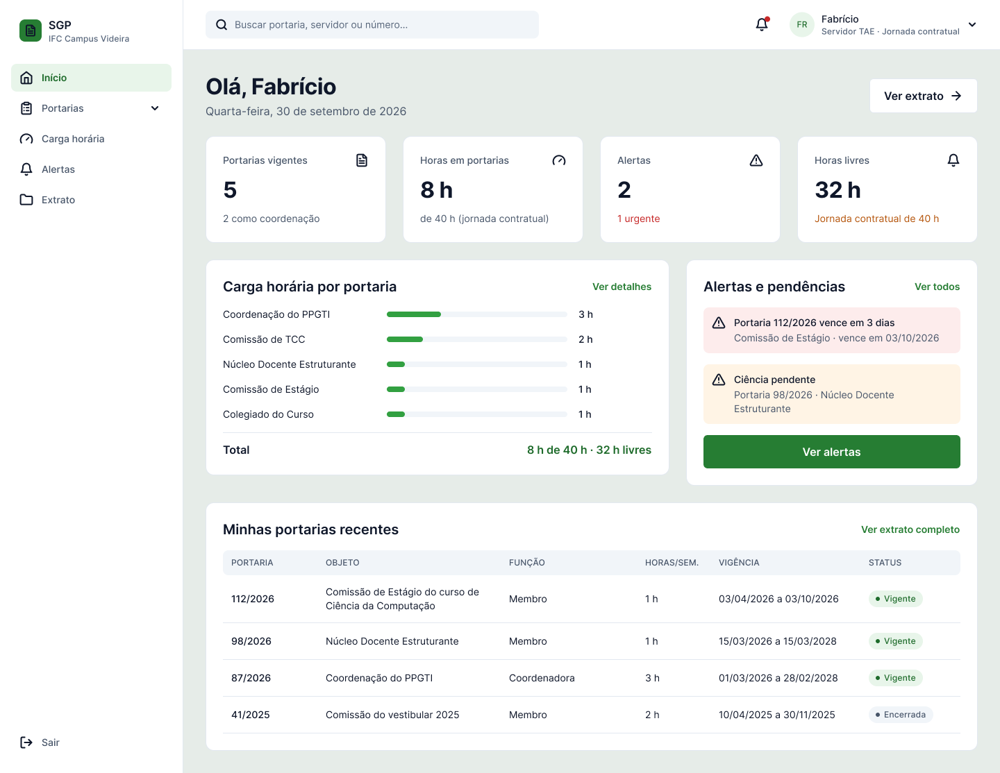
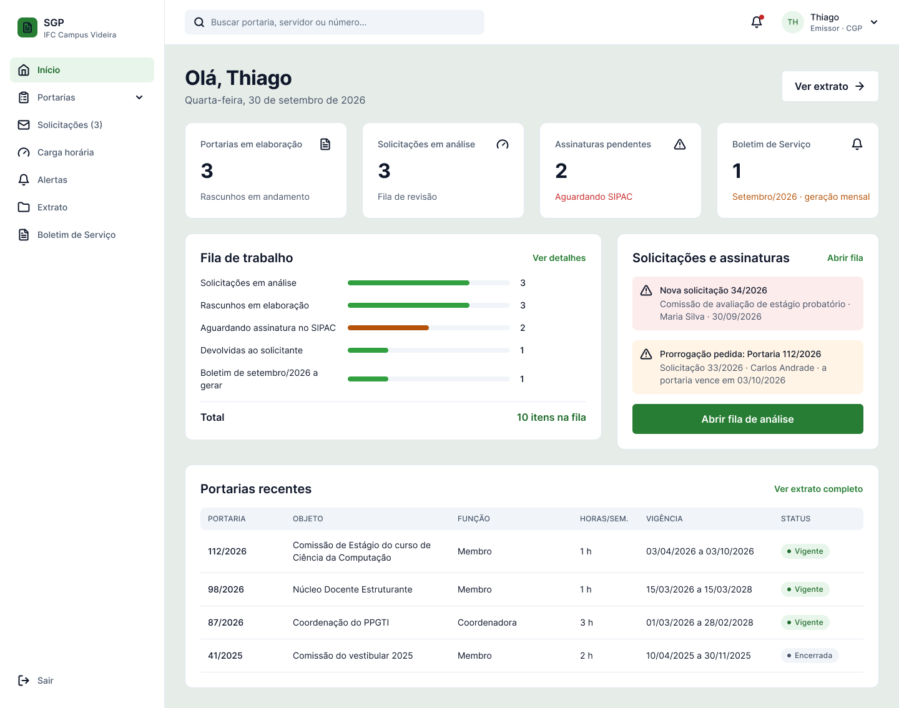
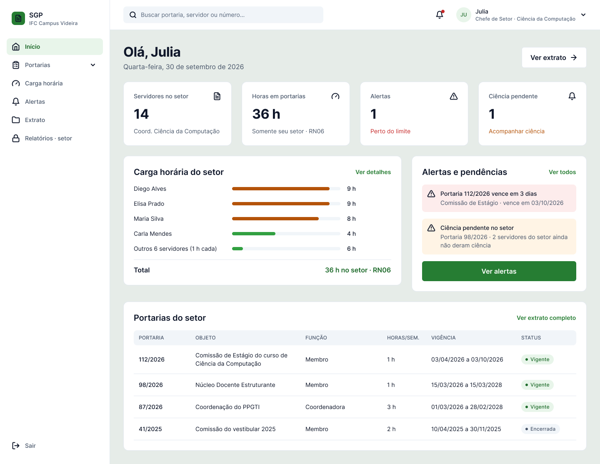
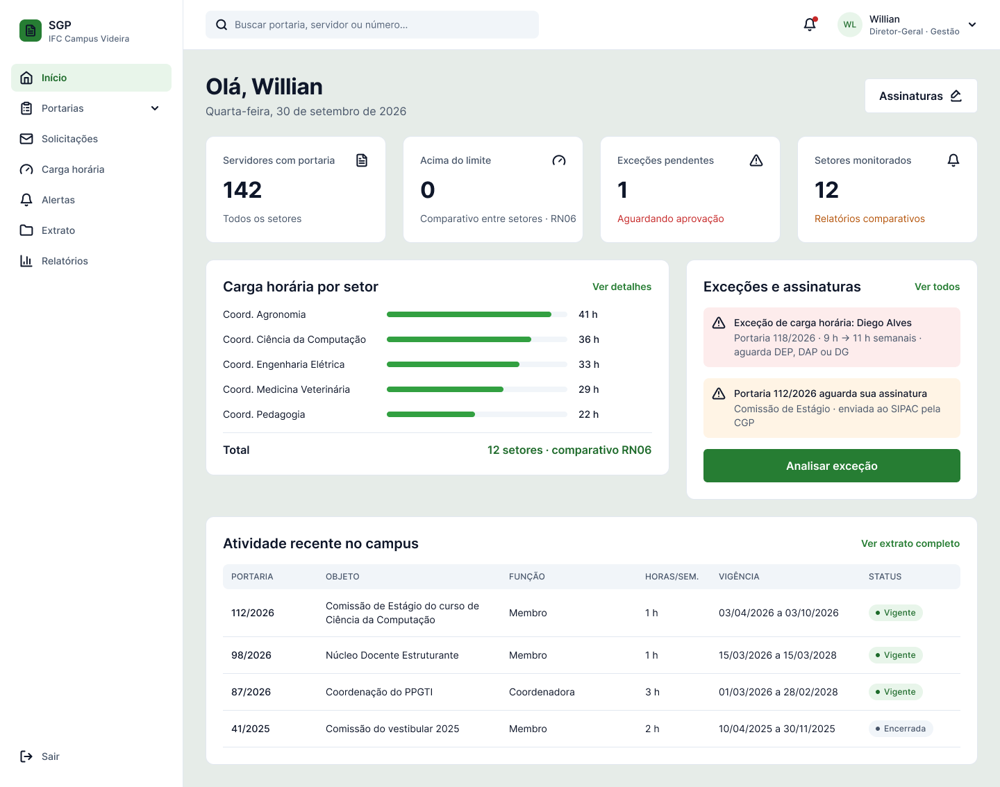

# 07 – Interfaces

As três interfaces exigidas no trabalho estão na página **Telas (protótipo)** do Figma, nas seções **Login** e **Painéis**. Todas usam a largura de 1440 px, a fonte Inter e os componentes e estilos descritos em [10 – Design system](10-design-system.md).

| Interface | Telas no Figma | Fluxo inicial do protótipo |
|---|---|---|
| a) Login com usuário e senha | Login – Seletor de Perfil (Servidor) · Login — Padrão — Docente, Emissor, Chefe de Setor e Diretor-Geral · Login – Erro (e uma versão por perfil) · Login – Carregando | 1. Visitante · 3. Login com erro · 4 a 8 (um por perfil) |
| b) Recuperação de senha | Recuperar senha – 1. Pedir link · 2. Link enviado · 3. Nova senha · 4. Senha alterada | 3b. Recuperar senha |
| c) Home com menu | Painel – Início (Docente) · (TAE) · (Emissor) · (Chefia) · (Gestão) | 4 a 8 |

---

## a) Login com usuário e senha

**Objetivo:** autenticar o servidor com as credenciais institucionais. O **usuário é a matrícula SIAPE** e a **senha é a da rede institucional** (LDAP/AD da Reitoria, RNF01), sem cadastro próprio no SGP.

**Elementos**

| Elemento | Comportamento |
|---|---|
| Faixa **Ambiente de desenvolvimento** e abas de perfil | Só no protótipo: escolhe a pessoa de teste (Servidor, Docente, Emissor, Chefe de Setor, Diretor-Geral). A linha “Perfil padrão: …” mostra quem vai entrar |
| Campo **Matrícula** | Recebe a matrícula SIAPE |
| Campo **Senha** | Oculta por padrão; o ícone de olho mostra ou esconde a senha |
| **Esqueci minha senha** | Abre a recuperação de senha (interface b) |
| Botão **Entrar** | Grava o perfil escolhido nas variáveis do protótipo e abre o painel daquele perfil (o perfil Servidor passa antes pelo estado “Entrando…”) |
| “Problemas para entrar? Fale com a DTIC do campus.” | Orientação de suporte |
| Painel verde à direita | Resume o que o SGP oferece |

**Decisões de projeto**

- **No sistema real não há escolha de perfil no login.** O perfil (Servidor, Solicitante, Emissor, Chefia, Gestão) vem do cadastro institucional, e um usuário pode acumular perfis (RN05).
- **No protótipo, as abas simulam quem está entrando.** Sem elas, quem avalia teria de abrir um fluxo diferente para cada perfil. A faixa laranja “Ambiente de desenvolvimento” deixa claro que a escolha não faz parte do produto.

| Aba | Pessoa de teste | O que ela vê |
|---|---|---|
| Servidor | Fabrício · Servidor TAE, jornada contratual de 40 h | Painel pessoal sem limite docente |
| Docente | Maria · Docente EBTT, também Solicitante (presidente da Comissão de TCC) | Painel pessoal com limite de 10 h e Solicitações |
| Emissor | Thiago · TAE da CGP, Emissor | Fila de solicitações, Nova portaria e Boletim de Serviço |
| Chefe de Setor | Julia · Coordenação de Ciência da Computação | Relatórios só do próprio setor |
| Diretor-Geral | Willian · Gestão | Relatórios completos, exceções e assinaturas |

### Estado de erro

A mensagem geral aparece no topo do formulário; o campo de senha fica com borda vermelha e uma dica específica (“Verifique maiúsculas e minúsculas.”). O erro é sinalizado por cor, ícone e texto ao mesmo tempo, para não depender só da cor. Há uma versão da tela de erro para cada aba de perfil.

### Estado carregando

O botão mostra “Entrando…” enquanto o LDAP responde, evitando cliques repetidos. No protótipo, a tela avança sozinha para o painel.

---

## b) Recuperação de senha

Fluxo em quatro telas. Como a senha é a do LDAP, a troca vale para todos os sistemas institucionais.

| 1. Pedir link | 2. Link enviado |
|---|---|
|  |  |
| **3. Nova senha** | **4. Senha alterada** |
|  |  |

| Tela | O que o usuário faz | Detalhes |
|---|---|---|
| 1. Pedir link | Informa a matrícula SIAPE e clica em **Enviar link** | Lembra que a senha é a da rede institucional; orienta procurar a DTIC se não tiver acesso ao e-mail |
| 2. Link enviado | Abre o link recebido no e-mail institucional | O e-mail aparece parcialmente oculto (m••••••a@ifc.edu.br); o link vale 30 minutos; reenvio liberado após 60 s. No protótipo, o botão “Abrir link do e-mail (simulação)” leva à tela 3 |
| 3. Nova senha | Digita e confirma a nova senha | Checklist em tempo real: 8 caracteres, uma maiúscula, um número e as duas senhas iguais |
| 4. Senha alterada | Clica em **Ir para o login** | Confirmação e retorno ao login |

**Decisões de projeto**

- O pedido é feito pela matrícula, não pelo e-mail, porque o servidor sempre sabe a própria matrícula, e o e-mail institucional é buscado no cadastro.
- **Voltar ao login** está disponível nas telas 1 e 2.

---

## c) Home com menu

Cada perfil tem a própria Home. A estrutura é a mesma (menu lateral, barra superior, cabeçalho, quatro indicadores, dois cards e uma tabela), mas o conteúdo responde ao que aquele perfil precisa fazer primeiro.

**Exemplo principal:** a docente **Maria**, docente EBTT e coordenadora do PPGTI.

| Região | Conteúdo |
|---|---|
| **Menu lateral** (componente `Menu lateral RBAC`) | Início, Portarias (Listar portarias e Nova portaria), Solicitações, Carga horária, Alertas, Extrato, Relatórios, Boletim de Serviço e Sair. Cada item aparece conforme o perfil (tabela abaixo) e o item atual fica destacado |
| **Barra superior** (componente `Barra superior`) | Busca global (leva à busca de portarias), sino de notificações com indicador (leva aos alertas) e menu do usuário. Nome, iniciais e cargo vêm das variáveis gravadas no login |
| **Menu do usuário** | Nome e cargo, os perfis que a pessoa acumula (o atual marcado), Meu extrato e Sair |
| **Cabeçalho** | Saudação, data e atalho **Ver extrato** |
| **Indicadores** | Portarias vigentes (5) · Horas em portarias (8 h de 10 h) · Alertas (2, 1 urgente) · Ciência pendente (1) |
| **Carga horária por portaria** | Barras por portaria e total “8 h de 10 h · 2 h livres” (RF09) |
| **Alertas e pendências** | Portaria 112/2026 vence em 3 dias; ciência pendente da 98/2026, com botão **Dar ciência** (RF10) |
| **Minhas portarias recentes** | Número, objeto, função, horas, vigência e status |

### A Home de cada perfil

| Servidor TAE (Fabrício) | Emissor (Thiago) |
|---|---|
|  |  |
| **Chefia de setor (Julia)** | **Gestão (Willian)** |
|  |  |

| Perfil | Indicadores | Card principal | Card de pendências |
|---|---|---|---|
| Docente | Portarias vigentes, horas (de 10 h), alertas, ciência pendente | Carga horária por portaria | Alertas e pendências, com **Dar ciência** |
| Servidor TAE | Portarias vigentes, horas (de 40 h), alertas, horas livres | Carga horária por portaria, total “8 h de 40 h” | Alertas e pendências |
| Emissor | Portarias em elaboração, solicitações em análise, assinaturas pendentes, Boletim de Serviço | Fila de trabalho (10 itens) | Solicitações e assinaturas, com **Abrir fila de análise** |
| Chefia de setor | Servidores no setor, horas no setor, alertas, ciência pendente | Carga horária do setor, por servidor | Alertas e pendências do setor |
| Gestão | Servidores com portaria, acima do limite, exceções pendentes, setores monitorados | Carga horária por setor | Exceções e assinaturas, com **Analisar exceção** e o botão **Assinaturas** no cabeçalho |

### Menu por perfil

| Item do menu | Docente | Servidor TAE | Emissor | Chefia | Gestão |
|---|:-:|:-:|:-:|:-:|:-:|
| Início, Portarias (Listar portarias), Carga horária, Alertas, Extrato | ✔ | ✔ | ✔ | ✔ | ✔ |
| Solicitações | ✔ (nova solicitação) | | ✔ (fila de análise) | | ✔ (fila) |
| Nova portaria | | | ✔ | | |
| Relatórios | | | | ✔ (só o setor) | ✔ |
| Boletim de Serviço | | | ✔ | | |

**Decisões de projeto**

- Os mesmos itens de menu levam a lugares diferentes conforme o perfil: **Início** volta à Home de quem entrou, **Relatórios** abre o relatório do setor para a chefia e o completo para a Gestão, e **Solicitações** abre o formulário para quem pede e a fila para quem analisa.
- Cada bloco tem um atalho para a tela de detalhe: **Ver detalhes**, **Ver todos**, **Ver extrato completo**, **Dar ciência**, **Abrir fila de análise**, **Analisar exceção**.
- A cor só reforça o significado: urgente em vermelho e pendente em laranja, sempre acompanhados de ícone e texto.

## Demais telas do sistema

As outras telas estão documentadas em [08 – Prototipação funcional e navegável](08-prototipo-navegavel.md).
