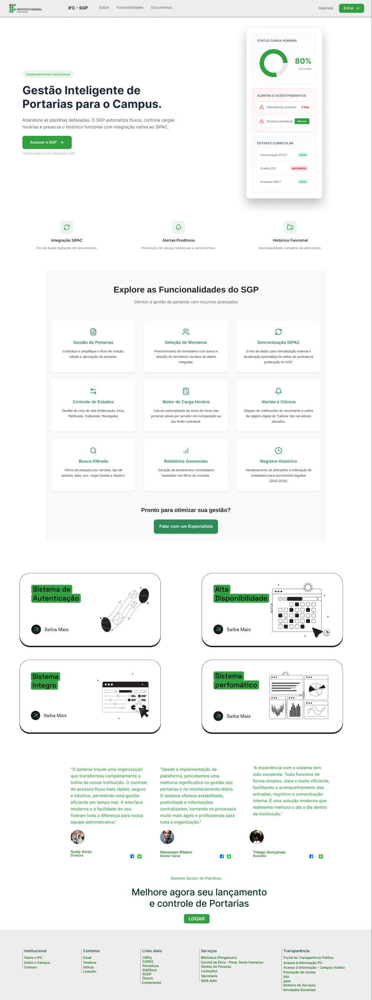
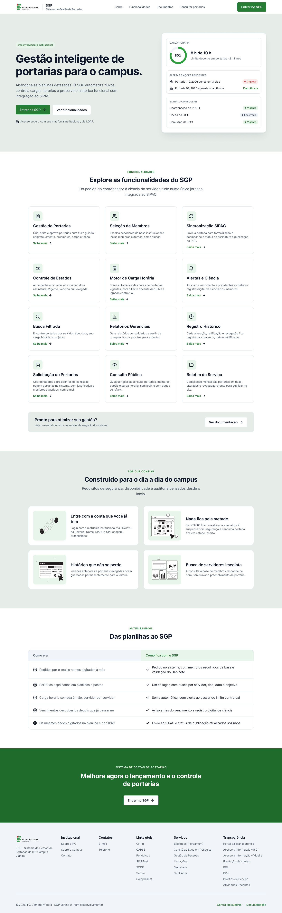
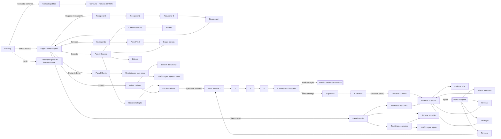
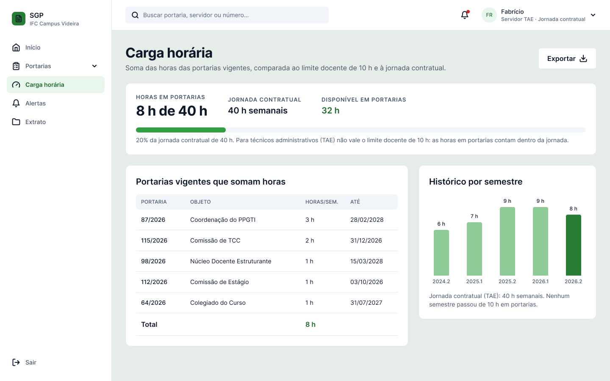
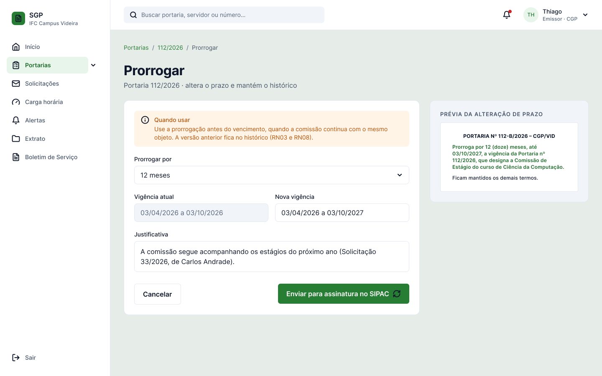
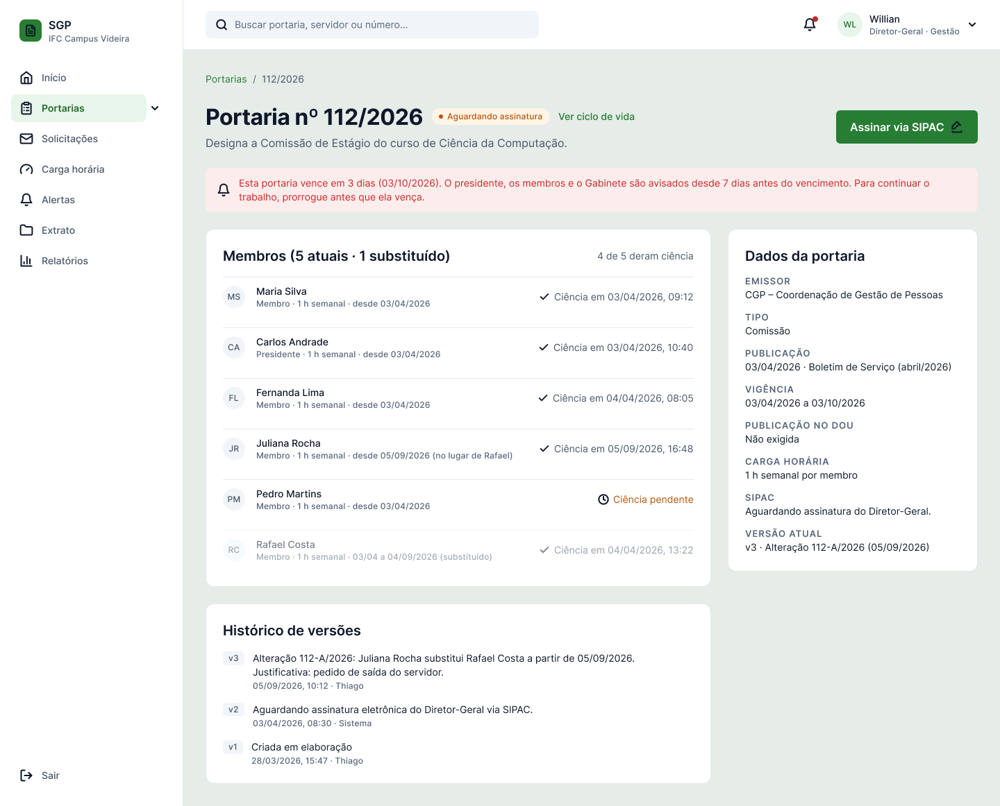
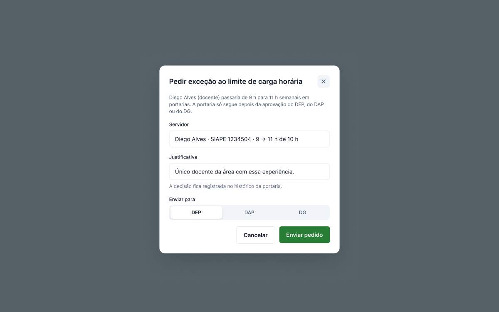
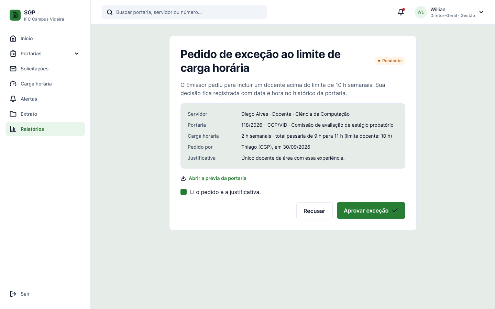
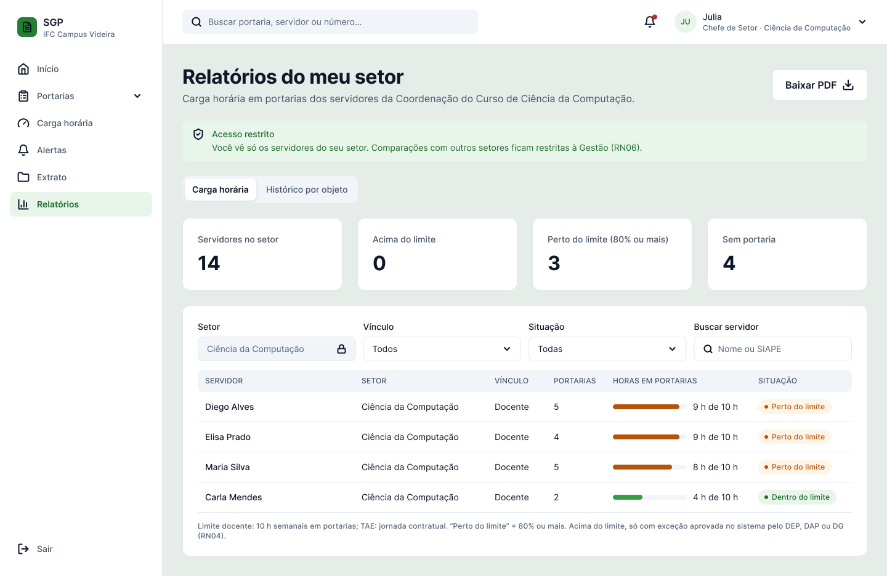

# 08 – Prototipação funcional e navegável

O protótipo está na página **Telas (protótipo)** do Figma. Todas as telas ficam na mesma página, porque o Figma não liga telas de páginas diferentes no modo de apresentação.

**Link do protótipo:** https://www.figma.com/proto/ezXFmUokd7Vfb36NjGNrG0?node-id=2010-2&starting-point-node-id=2010%3A2

## Evolução do protótipo

O protótipo foi construído de forma **evolutiva**: cada versão aproveitou a anterior e incorporou o que a equipe aprendeu com a entrevista e com as revisões. Os arquivos antigos foram preservados como registro do processo.

| Nível de fidelidade | O que é | Onde está | Quando |
|---|---|---|---|
| **Primeira ideia** | Exploração visual da página de apresentação, com imagem de banco e marca provisória | Figma [“Prototipo”](https://www.figma.com/design/ryGXTREuug87cskuPtcKnq/Prototipo) | ES I |
| **Baixa fidelidade** | Anotações da entrevista e esboços de estrutura no Miro; wireframe em blocos cinza do painel | [Miro – anotações da entrevista](https://miro.com/app/board/uXjVGpKo8vo=/) · Figma [“LandPage”](https://www.figma.com/design/UeFGW2riPPnzz2iSBpjYOB/LandPage) | ES I |
| **Média fidelidade** | Landing page, painéis e login com cores do IFC, ainda sem componentes nem conexões completas | Figma [“LandPage”](https://www.figma.com/design/UeFGW2riPPnzz2iSBpjYOB/LandPage) | ES I e início de ES II |
| **Alta fidelidade** | Design system, 89 telas, 60 sobreposições e 2.648 interações, com menu e dados por perfil; revisado com a gravação da entrevista e com as respostas do professor | Arquivo principal deste projeto | ES II (Sprint 1 em diante) |

| Primeira ideia | Baixa fidelidade: wireframe do painel |
|---|---|
|  |  |
| **Média fidelidade: primeira landing page** | **Alta fidelidade: landing page atual** |
|  |  |

**O que mudou da média para a alta fidelidade:** os depoimentos com nomes fictícios deram lugar à comparação “Como era × Como fica”; o seletor de perfil do login virou uma simulação marcada como “Ambiente de desenvolvimento” (no sistema real o perfil vem do cadastro); as telas passaram a usar componentes e estilos; e as regras de negócio foram conferidas com a gravação da entrevista.

## Números

| Item | Quantidade |
|---|---|
| Telas | 89, incluindo o diagrama do ciclo de vida, os logins e painéis de cada perfil e as variações de abas e opções (por exemplo, Gabinete ou CGP e tipo de prazo na nova portaria) |
| Sobreposições (modais, menus, listas de seleção e avisos) | 60 |
| Interações configuradas | 2.648 (931 condições por perfil e 808 gravações de variável) |
| Fluxos iniciais (pontos de partida) | 9 |
| Seções na página | 12 |

## Como navegar

1. Abra o link do protótipo (ou, no arquivo, clique em **Apresentar ▶** na página Telas).
2. No painel **Fluxos**, à esquerda, escolha o fluxo do perfil que quer testar. Os fluxos de perfil começam no login daquele perfil.
3. Clique em qualquer área para ver em azul o que é clicável (comportamento padrão do Figma).
4. Para voltar ao início do fluxo, pressione **R**.

### Como o protótipo sabe quem entrou

O login grava a pessoa de teste em variáveis da coleção **Estado do protótipo** (nome, iniciais, cargo, perfil e acessos). A partir daí:

- a barra superior e o menu do usuário mostram o nome e os perfis de quem entrou;
- os itens do menu lateral aparecem ou somem conforme os acessos (Solicitações, Nova portaria, Relatórios, Boletim de Serviço);
- **Início**, **Relatórios**, **Solicitações** e o logotipo usam condições: cada perfil vai para a própria tela;
- a tela Carga horária mostra “de 10 h” para docentes e “de 40 h” (jornada contratual) para o servidor TAE.

| Variável | Para que serve |
|---|---|
| `RBAC/Usuário ativo`, `RBAC/Iniciais ativo`, `RBAC/Papel ativo` | Nome, iniciais e cargo na barra superior e no menu do usuário |
| `RBAC/Perfil Docente`, `TAE`, `Emissor`, `Chefia`, `Gestão` | Qual perfil entrou; usadas nas condições de navegação |
| `RBAC/Acesso Solicitações`, `Nova portaria`, `Relatórios`, `Boletim` | Mostram ou escondem os itens do menu lateral |
| `RBAC/Limite docente` | Escolhe a versão docente ou TAE da tela Carga horária |
| `RBAC/Menu perfil 1` e `2` (com descrição) e `RBAC/Menu tem perfil 2` | Perfis acumulados no menu do usuário |
| `Perfil selecionado` | Aba marcada no login |
| `Sidebar/Portarias expandida` | Abre e fecha o submenu de Portarias |

## Fluxos

### 1. Visitante: landing → login

Landing → **Entrar no SGP** → Login (aba Servidor) → **Entrar** → “Entrando…” (avança sozinho em 1,2 s) → Painel do servidor TAE.
Na landing, os 12 cards de funcionalidade abrem sobreposições navegáveis entre si (anterior, próxima, fechar). Sobre e Funcionalidades rolam a página; Consultar portarias leva à consulta pública.

### 2. Consulta pública (sem login)

Consulta pública – busca → linha **98/2026** → Consulta pública – Portaria 98/2026 → **Baixar PDF** (aviso “Arquivo gerado”). O cabeçalho volta à landing ou leva ao login.

### 3. Login com erro · 3b. Recuperar senha

- **3:** Login – Erro → abas de perfil (cada uma com a sua versão de erro) → **Entrar** → painel do perfil escolhido.
- **3b:** Recuperar senha 1 → **Enviar link** → 2 (reenviar mostra o aviso “Link reenviado”) → **Abrir link do e-mail (simulação)** → 3 → **Salvar nova senha** → 4 → **Ir para o login**.

### 4. Docente (Maria): painel, ciência e solicitação

Login — Docente → **Entrar** → Painel (Docente) → **Dar ciência na Portaria 98/2026** → Ciência → **Estou ciente do teor** → Alertas.
Pelo menu: Carga horária (8 h de 10 h; exportar gera aviso), Alertas (abas por tipo; Ver portaria, Dar ciência, Solicitar prorrogação), Extrato (abas Todas/Vigentes/Encerradas/Revogadas; Exportar PDF).
**Solicitações** abre a nova solicitação: tipo de pedido (nova portaria, alteração de membros ou prorrogação), destino (Gabinete ou CGP), tipo de prazo (determinado, data fechada ou indeterminado), membros sugeridos e **Membro externo** (aluno, comunidade ou empresa) → **Enviar solicitação** → o pedido aparece na fila do Emissor.
O avatar abre o **menu do usuário**, com a troca entre Servidor e Solicitante, Meu extrato e Sair.

### 5. Servidor TAE (Fabrício): painel e jornada

Login – Servidor → **Entrar** → “Entrando…” → Painel (TAE): 8 h de 40 h e 32 h livres. Carga horária mostra a versão TAE (20% da jornada contratual, sem o limite docente de 10 h). Alertas, Extrato e Ciência funcionam como no fluxo 4. O menu não tem Solicitações, Nova portaria nem Relatórios.

### 6. Emissor (Thiago): fila, nova portaria, exceção, ações e Boletim

1. **Painel (Emissor)** → **Abrir fila de análise** (ou Solicitações no menu) → **Solicitações – fila do Emissor**: abas Em análise, Devolvidas e Aprovadas → **Aprovar e elaborar** (ou Devolver).
2. **Nova portaria 1 a 4**: na etapa 1, setor emissor (Gabinete ou CGP), tipo de prazo e “Exige publicação no DOU?” mudam a tela; cada etapa tem Continuar e Voltar; o indicador de etapas permite voltar a uma etapa concluída; **Salvar rascunho** mostra o aviso.
3. **Etapa 5 – Membros**: Diego Alves passaria de 9 h para 11 h; o alerta bloqueia o **Continuar**. O link **Pedir exceção ao DEP, DAP ou DG** abre o modal do pedido (servidor, justificativa e destinatário) → **Enviar pedido** → aviso “Exceção solicitada”. Ou o **X** da linha do Diego leva à versão **ajustada**, com Fábio Nunes no lugar.
4. **Etapa 6 – Revisão**: cada bloco tem **Editar**; **Enviar para assinatura no SIPAC** volta à lista de portarias.
5. **Portaria 112/2026 – detalhe** → **Ver ciclo de vida** (diagrama) ou **Ações** (menu sobreposto):
   - **Alterar membros** → Enviar para assinatura → volta ao detalhe;
   - **Retificar** → Enviar para assinatura → volta ao detalhe;
   - **Prorrogar** → novo prazo, justificativa e prévia da alteração 112-B/2026 → Enviar para assinatura → volta ao detalhe;
   - **Revogar** → “Com portaria substituta” ou “Sem substituta” → **Continuar para a nova portaria**.
6. **Portarias – busca** (filtros; **Limpar filtros** mostra aviso; **Gerar relatório** gera arquivo) e **Boletim de Serviço** (menu) → **Gerar boletim (PDF)**.

### 7. Chefia (Julia): relatórios do setor

Login — Chefe de Setor → Painel (Chefia): carga horária por servidor do setor → **Relatórios · setor** (menu) ou **Ver detalhes** → **Relatórios do meu setor**: só os servidores da Ciência da Computação, com o filtro de setor travado; aba **Histórico por objeto** (quem participou de um órgão ou contrato em um ano); **Baixar PDF**.

### 8. Gestão (Willian): relatórios, exceções e assinaturas

Login — Diretor-Geral → Painel (Gestão):
- **Analisar exceção** (ou o pedido no card, ou o indicador Exceções pendentes) → pedido de Diego Alves → **Aprovar exceção** ou **Recusar** → aviso com a decisão, registrada no histórico;
- **Assinaturas** (ou a portaria no card) → Portaria 112/2026 aguardando assinatura → **Assinar via SIPAC** → detalhe da portaria;
- **Relatórios** (menu, **Ver detalhes** ou o indicador Setores monitorados) → **Relatórios gerenciais**: todos os setores, faixa “1 pedido de exceção aguarda sua aprovação”, abas Carga horária e Histórico por objeto, **Baixar PDF**.

## Mapa de navegação

## Telas

### Painéis pessoais

| Carga horária (docente) | Carga horária (servidor TAE) |
|---|---|
|  |  |
| **Alertas e ações pendentes** | **Extrato curricular** |
|  |  |
| **Ciência** | |
|  | |

### Solicitações

| Nova solicitação (docente) | Fila do Emissor |
|---|---|
|  |  |

### Nova portaria (6 etapas)

| 1. Dados gerais | 4. Corpo |
|---|---|
|  |  |
| **5. Membros – bloqueio pela RN04** | **6. Revisão e envio** |
|  |  |

### Portarias

| Busca | Detalhe com histórico |
|---|---|
|  |  |
| **Alterar membros (112-A/2026)** | **Prorrogar (112-B/2026)** |
|  |  |
| **Boletim de Serviço** | **Aguardando assinatura no SIPAC (Gestão)** |
|  |  |

O diagrama do ciclo de vida, aberto por **Ver ciclo de vida** no detalhe, está em [05 – Requisitos](05-requisitos.md).

### Exceção ao limite de carga horária

| Pedido do Emissor (modal) | Aprovação pelo DEP, DAP ou DG |
|---|---|
|  |  |

### Relatórios e consulta pública

| Relatórios gerenciais (Gestão) | Relatórios do meu setor (Chefia) |
|---|---|
|  |  |
| **Consulta pública** | |
|  | |

## Tipos de interação usados

| Interação no Figma | Onde |
|---|---|
| **Navegar para** (Navigate) | Menu lateral, botões, breadcrumbs, linhas de tabela |
| **Abrir sobreposição** (Open overlay) | Modais de funcionalidade, menus do usuário, menu de ações, listas de seleção, modal de membro externo, avisos |
| **Rolar até** (Scroll to) | Links Sobre e Funcionalidades da landing; cabeçalho da consulta pública |
| **Mudar para** (Change to, variantes interativas) | Hover em botões e cards; segmentos e abas que alternam ao clicar; submenu de Portarias |
| **Definir variável** (Set variable) | Botões **Entrar** do login gravam a pessoa de teste; o grupo Portarias guarda se o submenu está aberto |
| **Condicional** (If) | Início, Relatórios, Solicitações e logotipo levam cada perfil à sua tela; a troca de perfil no menu do usuário |
| **Após atraso** (After delay) | “Entrando…” avança para o painel; avisos se fecham sozinhos |
| **Voltar** (Back) | “← Voltar à portaria” no diagrama do ciclo de vida |
| **Fechar sobreposição** | Botão X dos modais e clique fora dos menus |
| **Abrir link** (Open URL) | Links do rodapé para os sites do IFC |

## Listas de seleção e menus do usuário

Todos os campos de seleção do protótipo abrem uma **lista de opções** em sobreposição (23 listas, na seção **Seleções (sobreposições)**). A opção atual aparece destacada; clicar em qualquer opção ou fora da lista fecha a sobreposição.

O **menu do usuário**, aberto pelo avatar na barra superior, mostra o nome, o cargo e os perfis que a pessoa acumula, com o atual marcado, além de Meu extrato e Sair. O conteúdo vem das variáveis gravadas no login: a Maria vê Servidor e Solicitante; o Thiago, Emissor e Servidor; o Fabrício, só Servidor.

| Lista de seleção | Menu do usuário (Maria) |
|---|---|
|  |  |

## Limitações conhecidas

- **Somente desktop (decisão de escopo):** as telas foram desenhadas para 1440 px, porque o SGP é um sistema administrativo usado nos computadores do campus. A versão responsiva (celular e tablet) está no backlog como fase futura (US25), começando pela consulta pública.
- **Escolha de perfil no login:** existe só no protótipo, para simular cada pessoa de teste (ver [07](07-interfaces.md#a-login-com-usuário-e-senha)).
- Escolher outra opção numa lista fecha a sobreposição, mas o valor exibido no campo não muda (o Figma exigiria uma variante de tela para cada combinação). As escolhas mais importantes (tipo de pedido, destino, prazo, DOU, abas) têm variações de tela próprias.
- Os campos de texto não aceitam digitação; os valores são de exemplo.
- Nas telas pessoais compartilhadas (Alertas, Extrato, Ciência), a barra superior mostra quem entrou, mas os dados de exemplo são os da docente **Maria**.
- No modo de edição do Figma, as telas mostram os valores padrão das variáveis (o servidor TAE Fabrício); no modo de apresentação, mostram quem entrou.
- Elementos **intencionalmente sem destino:** o botão “Entrando…” (estado de carregamento) e o **Continuar** desabilitado da etapa 5 com bloqueio.

## Checklist de teste de navegação (Sprint 3)

| Fluxo | Testado por | Data | Resultado |
|---|---|---|---|
| 1. Visitante | | | |
| 2. Consulta pública | | | |
| 3. Login com erro | | | |
| 3b. Recuperar senha | | | |
| 4. Docente (Maria) | | | |
| 5. Servidor TAE (Fabrício) | | | |
| 6. Emissor (Thiago) | | | |
| 7. Chefia (Julia) | | | |
| 8. Gestão (Willian) | | | |
