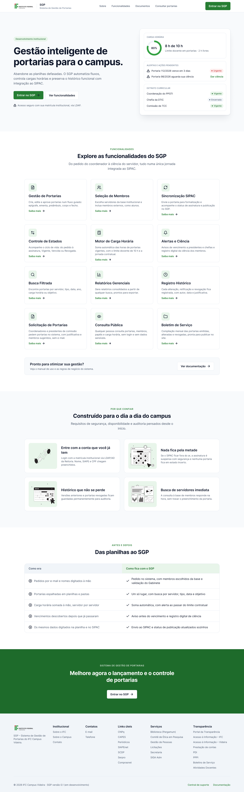
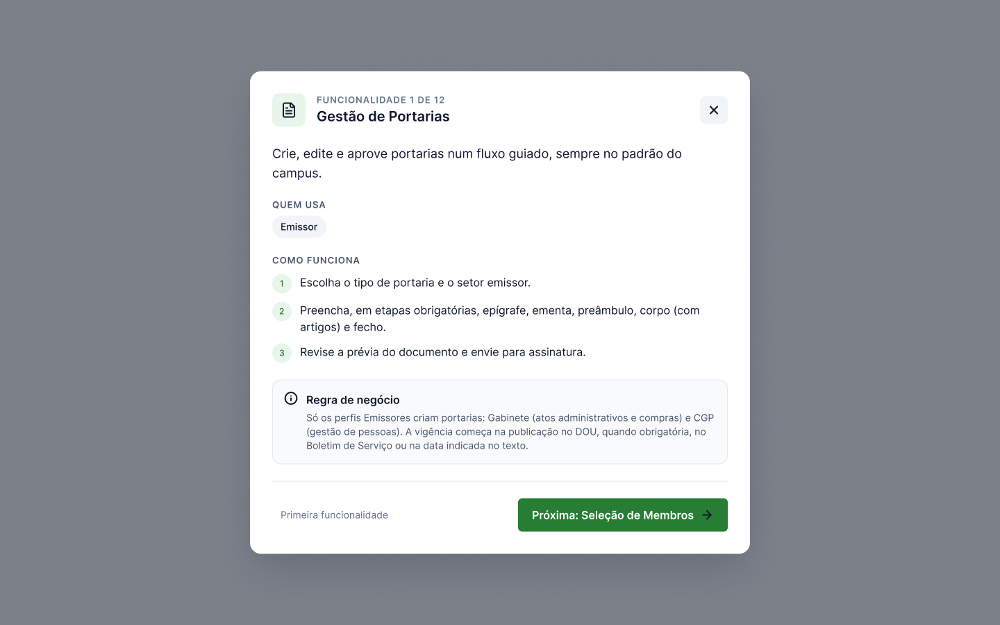

# 09 – Landing page

A landing page é a porta de entrada pública do SGP. Ela apresenta o sistema aos servidores, leva ao login e à consulta pública e explica cada funcionalidade em sobreposições, sem exigir login.

**No Figma:** página **Telas (protótipo)**, seção **Landing** (tela de 1440 × 4652 px), com as 12 sobreposições na seção **Funcionalidades (sobreposições)**. Fluxo inicial: **1. Visitante**.

## Seções

| # | Seção | Conteúdo | Interações |
|---|---|---|---|
| 1 | **Cabeçalho** (componente `Cabeçalho da landing`) | Logo do IFC, nome do sistema, links Sobre, Funcionalidades, Documentos e Consultar portarias; botão **Entrar no SGP** | Sobre e Funcionalidades rolam a página; Documentos e Consultar portarias levam à consulta pública; Entrar leva ao login |
| 2 | **Hero** | Título “Gestão inteligente de portarias para o campus.”, texto de apoio, botões **Entrar no SGP** e **Ver funcionalidades**, nota sobre o acesso via LDAP | Botões com hover; Ver funcionalidades rola até a seção 3 |
| 3 | **Prévia do painel** | Cartão com a carga horária (8 h de 10 h), alertas e extrato, mostrando o que o servidor encontra ao entrar | **Dar ciência** leva ao login |
| 4 | **Funcionalidades** | 12 cards: Gestão de Portarias, Seleção de Membros, Sincronização SIPAC, Controle de Estados, Motor de Carga Horária, Alertas e Ciência, Busca Filtrada, Relatórios Gerenciais, Registro Histórico, Solicitação de Portarias, Consulta Pública, Boletim de Serviço | Hover em cada card; o clique abre a sobreposição da funcionalidade |
| 5 | **Chamada para a documentação** | “Pronto para otimizar sua gestão?” e botão **Ver documentação** | Abre a primeira sobreposição de funcionalidade |
| 6 | **Por que confiar** | Quatro garantias: entrar com a conta institucional, nada fica pela metade (SIPAC fora do ar), histórico que não se perde, busca de servidores imediata | — |
| 7 | **Das planilhas ao SGP** | Tabela “Como era × Como fica com o SGP” com cinco problemas reais levantados na entrevista | — |
| 8 | **Chamada final** | Faixa verde “Melhore agora o lançamento e o controle de portarias” e botão **Entrar no SGP** | Leva ao login |
| 9 | **Rodapé** | Institucional, Contatos, Links úteis, Serviços e Transparência; versão do sistema | Links para os sites do IFC; os demais mostram o aviso de link externo |

## Sobreposições de funcionalidade

Cada uma das 12 sobreposições tem a mesma estrutura:

- ícone, “Funcionalidade N de 12” e título;
- descrição curta;
- **Quem usa** (perfis);
- **Como funciona** em três passos;
- **Regra de negócio** relacionada, com a referência à RN;
- navegação **Anterior / Próxima** entre as 12 e botão de fechar; clicar no fundo escurecido também fecha.

## Decisões de conteúdo

- **A seção “Das planilhas ao SGP”** usa os problemas citados pelo Diretor-Geral na entrevista (pedidos por e-mail, portarias espalhadas, carga horária somada à mão, vencimentos descobertos depois, dados digitados duas vezes), para que a página fale a língua de quem vai usar.
- **Não há depoimentos inventados.** A comparação “como era × como fica” ocupa esse espaço.
- **A consulta pública aparece no cabeçalho**, porque portarias são atos públicos (RN06) e qualquer pessoa pode consultá-las sem login.
- **O selo “Desenvolvimento institucional”** e a versão “0.1 (em desenvolvimento)” no rodapé deixam claro que se trata de um projeto em andamento.

## Critérios de aceitação

Ver [CA-LP1 a CA-LP6](04-criterios-de-aceitacao.md#landing-page).
