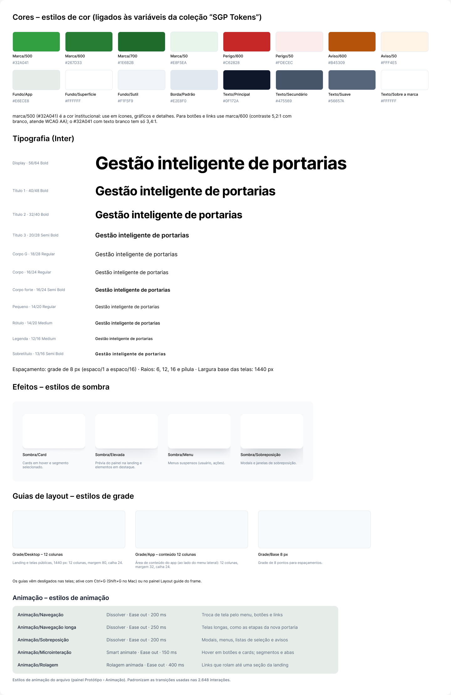

# 10 – Design system

O design system está na página **Design System** do Figma. As telas usam só os componentes, as variáveis e os estilos descritos aqui. A identidade segue o ambiente do IFC: verde institucional, logotipo oficial e linguagem dos documentos do serviço público.

## Recursos do Figma usados

| Recurso | Quantidade | Onde ver no Figma |
|---|---|---|
| Variáveis de design (coleção “SGP Tokens”) | 28 | Painel **Local variables** |
| Variáveis de estado do protótipo (coleção “Estado do protótipo”) | 21 | Painel **Local variables**; uso descrito em [08](08-prototipo-navegavel.md#como-o-protótipo-sabe-quem-entrou) |
| Estilos de cor | 16 | **Assets › Estilos de cor**, ligados às variáveis |
| Estilos de texto | 11 | **Assets › Estilos de texto** |
| Estilos de efeito (sombras) | 4 | **Assets › Estilos de efeito** |
| Estilos de grade (guias de layout) | 3 | **Assets › Guias de layout** |
| Componentes e conjuntos de variantes | 13 + 34 ícones | Página **Design System** |
| Sobreposições | 60 (modais, menus, listas de seleção e avisos) | Página **Telas (protótipo)** |
| Estilos de animação | 5 | **Assets › Estilos de animação** |
| Variantes interativas | Botão, Card, Segmento, Status | Hover e alternância ao clicar |

## Princípios de design aplicados

Os quatro princípios de design vistos na disciplina orientaram as telas:

| Princípio | Objetivo | Onde aparece no SGP |
|---|---|---|
| **Proximidade** | Organizar as informações | Rótulo junto do campo; dados da portaria agrupados em cards (membros, dados, histórico) |
| **Alinhamento** | Unificar e organizar a página | Grade de 12 colunas e base de 8 px; conteúdo alinhado ao menu lateral em todas as telas |
| **Repetição** | Unificar e dar consistência | Mesmos componentes (botão, status, campo, card) e estilos em todas as telas |
| **Contraste** | Criar hierarquia e atrair o olhar | Uma única ação primária verde por tela; títulos em Título 2; alertas em vermelho e laranja |

A ordem de trabalho seguiu a regra “UX antes da UI”: primeiro os fluxos e as regras (entrevista, requisitos, fluxos por perfil) e depois o acabamento visual.

## Paleta de cores

| Estilo | Hex | Uso |
|---|---|---|
| Marca/500 – Verde institucional | `#32A041` | Ícones, gráficos e detalhes (verde do IFC) |
| Marca/600 – Ação | `#267D33` | Botões e links (contraste 5,2:1 com branco, WCAG AA) |
| Marca/700 | `#1E6B2B` | Hover dos botões e faixas de destaque |
| Marca/50 | `#E8F5EA` | Fundo do item ativo do menu, selos “Vigente” |
| Perigo/600 | `#C62828` | Erros, bloqueios, “Revogada”, “Urgente” |
| Perigo/50 | `#FDECEC` | Fundo de alertas críticos |
| Aviso/600 | `#B45309` | “Perto do limite”, “Pendente”, “Aguardando assinatura” |
| Aviso/50 | `#FFF4E5` | Fundo de avisos |
| Fundo/App | `#E6ECE8` | Fundo das telas (verde-acinzentado, aplicado pelo estilo em todas as telas) |
| Fundo/Superfície | `#FFFFFF` | Cards, tabelas e formulários |
| Fundo/Sutil | `#F1F5F9` | Cabeçalhos de tabela, segmentos |
| Borda/Padrão | `#E2E8F0` | Bordas e divisórias |
| Texto/Principal | `#0F172A` | Títulos e texto |
| Texto/Secundário | `#475569` | Descrições |
| Texto/Suave | `#56657A` | Legendas e placeholders (contraste de 4,95:1 sobre o Fundo/App e 5,94:1 sobre branco) |
| Texto/Sobre a marca | `#FFFFFF` | Texto sobre o verde |

`Marca/500` (#32A041) é a cor institucional, mas com texto branco tem contraste de só 3,4:1. Por isso, botões e links usam `Marca/600`.

O Fundo/App passou de `#F8FAFC` para `#E6ECE8` na fase final, para separar melhor os cards brancos do fundo. Com a troca, o Texto/Suave foi escurecido de `#64748B` (3,97:1 no fundo novo, abaixo do mínimo) para `#56657A`, que atende ao WCAG AA.

## Tipografia (Inter)

| Estilo | Tamanho / altura de linha | Peso | Uso |
|---|---|---|---|
| Display | 56/64 | Bold | Título da landing |
| Título 1 | 40/48 | Bold | Títulos de seção da landing |
| Título 2 | 32/40 | Bold | Título das telas |
| Título 3 | 20/28 | Semi Bold | Títulos de cards e etapas |
| Corpo G | 18/28 | Regular | Textos de apoio |
| Corpo | 16/24 | Regular | Texto padrão e campos |
| Corpo forte | 16/24 | Semi Bold | Botões e ênfases |
| Pequeno | 14/20 | Regular | Tabelas e descrições |
| Rótulo | 14/20 | Medium | Rótulos de campos |
| Legenda | 12/16 | Medium | Selos e metadados |
| Sobretítulo | 13/16 | Semi Bold | Rótulos em caixa alta |

## Efeitos

| Estilo | Uso |
|---|---|
| Sombra/Card | Cards em hover e segmento selecionado |
| Sombra/Elevada | Prévia do painel na landing e elementos em destaque |
| Sombra/Menu | Menus suspensos (usuário, ações) |
| Sombra/Sobreposição | Modais |

## Guias de layout

| Estilo | Configuração |
|---|---|
| Grade/Desktop – 12 colunas | Landing e telas públicas, 1440 px: 12 colunas, margem 80, calha 24 |
| Grade/App – conteúdo 12 colunas | Área de conteúdo ao lado do menu lateral: 12 colunas, margem 32, calha 24 |
| Grade/Base 8 px | Grade de 8 pontos para espaçamentos |

Os guias vêm desligados nas telas; para ver, use **Ctrl+G** (ou **Shift+G** no Mac).

Espaçamentos em múltiplos de 8 px; raios de 6, 12 e 16 px e pílula.

## Componentes

| Componente | Variantes e propriedades | Uso |
|---|---|---|
| **Botão** | 16 variantes (Tipo: Primário, Secundário, Fantasma, Perigo × Estado: Padrão, Hover, Desabilitado, Carregando); propriedades Rótulo, Mostrar ícone, Ícone | Todas as ações; hover interativo |
| **Status** | 17 variantes: Solicitada, Em análise, Devolvida, Em elaboração, Aguardando assinatura, Vigente, Alterada, Retificada, Vencida, Revogada, Encerrada, Pendente, Urgente, Dentro do limite, Perto do limite, No limite, Acima do limite | Selos de estado da portaria (RF06) e da carga horária (RN04) |
| **Campo de texto** | 4 variantes (Padrão, Foco, Erro, Desabilitado); propriedades Rótulo, Valor, Ajuda, Mostrar ajuda, Mostrar ícone, Ícone | Formulários |
| **Segmento** | 2 variantes (Padrão, Selecionado); propriedade Texto; alterna ao clicar | Abas e escolhas exclusivas (prazo, DOU, setor) |
| **Seletor de perfil** | — | Troca de perfil no menu do usuário |
| **Card de funcionalidade** | 2 variantes (Padrão, Hover); propriedades Título, Descrição, Ícone, Mostrar link | Landing |
| **Item de menu** | 2 variantes (Padrão, Ativo); propriedades Texto, Ícone | Menu lateral |
| **Subitem de menu** | 2 variantes (Padrão, Ativo); propriedade Texto | Listar portarias e Nova portaria, dentro de Portarias |
| **Grupo de navegação — Portarias** | 4 variantes (Estado: Padrão, Ativo × Expandido: Sim, Não) | Abre e fecha o submenu de Portarias |
| **Menu lateral** | Itens de menu + Sair; itens de acesso restrito ligados às variáveis `RBAC/Acesso …` | Telas internas compartilhadas |
| **Menu lateral RBAC** | 5 variantes (Perfil: Gestão, Emissor, Chefia, Docente, TAE) | Painel inicial de cada perfil |
| **Barra superior** | Propriedades Nome, Perfil, Iniciais | Todas as telas internas |
| **Cabeçalho da landing** | — | Landing e consulta pública |
| **Ícones** | 34 componentes `Icon/…` (documento, pessoas, sincronizar, busca, sino, alerta, check, cadeado, escudo, e-mail…) | Usados por instância e trocados pela propriedade Ícone |

## Imagens e ilustrações

- **Logotipo oficial do IFC** no cabeçalho da landing, no login e no rodapé.
- **Ilustrações** em traço na seção “Por que confiar” da landing (login, calendário, histórico e busca).
- **Diagrama do ciclo de vida** da portaria como tela própria do protótipo.

## Estilos de animação

O professor exige estilos de animação, além dos de cor, texto, efeito e grade (22/10/2026). Os estilos abaixo padronizam as transições usadas nas 2.648 interações do protótipo: todas as transições do arquivo usam exatamente uma destas combinações. A API usada para montar o arquivo não cria estilos de animação, então eles são criados direto no Figma pela equipe.

| Estilo | Animação | Curva | Duração | Onde é usado |
|---|---|---|---|---|
| Animação/Navegação | Dissolver | Ease out | 200 ms | Troca de tela pelo menu, botões e links |
| Animação/Navegação longa | Dissolver | Ease out | 250 ms | Telas longas, como as etapas da nova portaria |
| Animação/Sobreposição | Dissolver | Ease out | 200 ms | Modais, menus, listas de seleção e avisos |
| Animação/Microinteração | Smart animate | Ease out | 150 ms | Hover em botões e cards; segmentos e abas |
| Animação/Rolagem | Rolagem animada | Ease out | 400 ms | Links que rolam até uma seção da landing |

